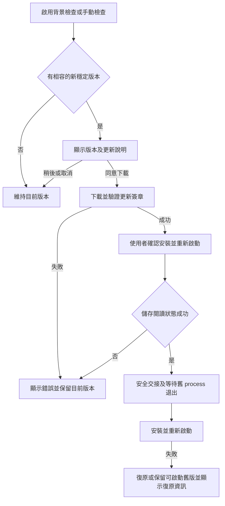

# MangaMeeya Rust — 確認式自動更新實作計畫

- 日期：2026-11-07
- 狀態：**已核准執行；第 7.1 節技術 gate 未通過，完整實作 blocked**
- Objective：方案 2｜下載後，由使用者確認並重新啟動更新
- 基準：`main`，`527b1de4f2ce3546d6e3cca1a866b9d2dcb614d1`，應用程式版本 `0.4.0`
- 預定實作分支：`narumi/feat/confirmed-auto-update`

## 1. 核准與執行規則

1. 草擬階段只新增本計畫，不修改程式、依賴、workflow 或安裝程式。
2. 使用者已指定本計畫並明確授權執行、commit、push 與建立 PR；目前已開始第 7.1 節的技術檢查。
   - 原核准決策不重新請求核准；若 SDK gate 失敗而需重大架構修訂，仍依規則 4 先更新計畫並取得修訂核准。
3. 實作前重新讀取 repository instructions，確認最新 `main` 與工作目錄；保留不相關變更。
4. 範圍、架構、重大風險或必要驗收條件改變時，先更新計畫並取得核准。
   - 不以關閉簽章驗證、略過平台測試或改成手動下載頁來代替本方案。
5. 實作完成後以專用分支交付 PR；只 stage 預定檔案，使用 Conventional Commits。
6. 不發布套件、不建立版本 tag、不手動 dispatch release workflow、不建立付費帳號或更改 GitHub 權限／secrets。
   - 可修改並測試未來 release automation，不能把本次程式交付當成正式發布授權。
7. 只有必要工作與驗收檢查都有證據時，才回報 `DONE`。
   - 正式金鑰、簽署身分或平台證據不足時，列出 blocker；不能宣稱 production 更新已驗證。

## 2. 現況與目標

目前已有 GitHub Releases、Windows x64 NSIS installer，以及 macOS arm64／x86_64 ZIP 和 DMG。Linux 只有 CI，沒有發行套件。程式尚無更新引擎。

已確認的整合風險：

1. `src/ui.rs` 的退出與關閉視窗路徑會嘗試儲存，但儲存錯誤目前不會阻止退出。更新退出不能沿用「只記錄錯誤仍繼續」的行為。
2. 設定採 `serde(default, deny_unknown_fields)`。直接新增更新偏好到主要 settings JSON，會使舊版無法讀取，影響更新失敗後的復原。
3. `PrimaryInstance` 隨 `ReaderView` 持有；view 釋放不等於原 process 已完全退出。更新不能只等待 instance lock 釋放或使用固定 sleep。
4. NSIS 目前覆寫檔案，沒有更新專用的 process 等待、完整失敗檢查或復原流程。現有 installer 測試只證明全新安裝與解除安裝。
5. Windows 套件未做 Authenticode signing；macOS 套件只有 ad-hoc signing，沒有 Developer ID signing 或 notarization。
6. Release 先建立，再上傳五個附件；新 tag 出現不代表更新資產已完整。

目標流程：

## 3. 範圍與界線

### 3.1 納入

1. Windows x64、macOS arm64 與 macOS x86_64 的已安裝版本。
2. 手動檢查、可關閉的背景檢查、更新說明、下載進度、取消、簽章驗證、確認後安裝及重新啟動。
3. 安全儲存閱讀狀態、避免多重安裝、保留設定／書籤／最近開啟／閱讀位置／檔案關聯。
4. 更新所需的 native SDK、打包、feed 產生、簽署整合、CI fixture、三語系入口及文件。
5. 安裝失敗與復原測試，包含鎖定中的檔案、權限不足及交接時的並行啟動。

### 3.2 不納入

1. 不經確認的靜默安裝、強制更新、背景下載後在普通退出時自動安裝。
2. Linux 自動安裝、portable executable 自動覆寫、從 mounted DMG 直接更新。
3. prerelease channel、delta updates、自訂 feed URL、任意選版或自動降版。
4. Microsoft Store、Mac App Store、package manager 或新伺服器服務。
5. GUI 框架升級、閱讀器 UI 重設計、主要設定格式遷移或一般用途的 privileged helper。
6. 自行設計加密格式、自製 archive extractor、自製 macOS bundle replacement engine。

## 4. 架構決策

### 4.1 使用成熟的 native updater

| 平台 | 決策 | 安裝來源 |
| --- | --- | --- |
| Windows x64 | WinSparkle `0.9.4`，小型 Rust C ABI adapter | 既有 NSIS installer，補上安全更新模式 |
| macOS arm64／x86_64 | Sparkle `2.10.1`，小型 Objective-C／Rust bridge | 各架構已簽署的完整 ZIP app bundle |
| Linux | unsupported adapter；清楚顯示不支援自動安裝 | 不產生 Linux 更新資產 |

1. 沿用 native SDK 的下載、payload signature verification、進度與更新確認視窗。
   - 不新增另一套 Rust HTTP downloader 或平行的安裝狀態機。
   - GPUI 只負責入口、能力／忙碌狀態、偏好開關及安全退出交接。
2. 平台 adapter 分開，callback 交接與安全退出邏輯集中，不分散到各個 UI button。
   - 預定檔案為 `src/update.rs`、`src/update/windows.rs`、`src/update/macos.rs`、必要的 macOS bridge 與測試。
   - native callback 不直接跨 thread 操作 GPUI entity；使用有界事件／回覆機制，支援逾時及取消。
   - FFI 邊界不能傳出 Rust panic；callback、delegate 與 library 的生命週期必須完整管理。
3. SDK 版本與下載 SHA-256 固定；不追蹤 `latest`，不提交 SDK binary。
   - WinSparkle：`v0.9.4`，source commit `a8986caf620262f7d4581b241436ceaa0cc9370f`。
   - `WinSparkle-0.9.4.zip`：`6037df37fc263bd1650a1c4949681a9d40ffe991d01f35892a406cb5d103c976`。
   - Sparkle：`2.10.1`，source commit `ab7d71291238df6e0492143b120c9b696a35f603`。
   - `Sparkle-2.10.1.tar.xz`：`1a856d2a9edb8e628de88121d7be04cf0e2167f8641650b78fca00b14244cf27`。
4. Windows 只從已驗證安裝目錄的絕對路徑載入 DLL；macOS 只載入目前 app bundle 內的 framework。
   - 不從目前工作目錄、PATH、下載內容提供的 library path 或相鄰的不受信任目錄搜尋。
5. 一般 `cargo test`、Clippy 及未打包的開發執行不要求安裝 SDK，也不執行網路更新。
   - 採 runtime loading；正式打包缺少必要 SDK 或公鑰時必須失敗，不交付假裝能更新的套件。
   - SDK、nested framework／helper 的 bundle、架構、授權與 runtime library 需求在首個技術檢查中驗證。

### 4.2 版本、feed 與信任

1. 只接受同一 repository 的正式 stable release；比較實際版本，不以字串排序。
2. 每個 target 使用固定的 HTTPS appcast：
   - `appcast-windows-x64.xml`
   - `appcast-macos-arm64.xml`
   - `appcast-macos-x86_64.xml`
3. feed URL 使用本 repository 的 GitHub Releases `latest/download/<固定檔名>`。
   - 不需要額外網站或使用者 GitHub token。
   - arm64／x86_64 依目前執行的 app 架構選擇；不在更新時改換架構。
4. 使用每平台內建的 Ed25519 公鑰驗證更新包；Windows installer 與 macOS ZIP 都必須有有效 signature。
   - 不把 HTTPS、檔名、SHA-256 或同站下載的公鑰當成發行者身分證明。
   - 不接受 unsigned fallback，不在失敗後改用直接執行下載檔的路徑。
   - 公鑰只從受 review 的 build／bundle 資源取得；private key 不進 repository、PR artifact、log 或命令列。
5. feed 只提供版本、相容條件、下載位置與安全呈現的 release notes。
   - installer 執行參數由程式決定；不能執行 feed 中的任意 command、script 或 install directory。
   - release notes 使用安全跳脫的文字；不載入任意 remote HTML／script。
   - 測試 HTTPS redirect、錯誤 feed、過期／重播 feed、錯誤 target 與簽章不符。
6. 不能降版：Windows 更新 installer 需檢查內建版本與實際已安裝版本；macOS 驗證 bundle identifier、版本與 SDK 的 downgrade 防護。
   - 修改 feed 的版本欄位，不能使曾合法簽署的舊 installer／bundle 安裝成「新版本」。
7. Sparkle 啟用 extraction 前驗證；其 signed-feed 能力及信任設定依固定版本文件配置，不能使用逾期後降低驗證的 fallback。
   - WinSparkle 的 payload signature 驗證不代表整份 feed 已簽署；文件及測試必須區分。

### 4.3 使用者操作與偏好

1. Windows 的 Help／工具入口與 macOS application menu 提供「檢查更新」。Reading 的一般設定提供相同入口及「自動檢查更新」開關。
2. 初次使用先詢問是否允許背景檢查；未同意前不執行背景網路請求。
   - 同意後使用 SDK 的每日檢查排程；手動檢查不受此開關限制。
   - 不自己增加第二個 timer；不在每次視窗 render 時檢查更新。
3. 使用者必須同意下載；安裝前必須確認退出及重新啟動。
   - 關閉 SDK 的 automatic download／silent install 選項，包括 install-on-quit。
   - 稍後、取消或一般退出都不能在背後套用更新。
4. 更新偏好由 WinSparkle 的 per-user registry／Sparkle 的 NSUserDefaults 保存。
   - GPUI 讀寫同一份 SDK 偏好，不建立第二份來源。
   - 不新增主要 settings JSON 欄位，不改寫閱讀資料來儲存 updater 狀態。
5. 應用程式新增的入口、錯誤與交接提示支援 English、Japanese、Traditional Chinese。
   - native updater 視窗沿用 SDK localization；明確記錄是否依 OS language，而非假設跟隨 app 內的語系切換。
6. 未打包版本、Linux、mounted DMG、安裝位置不符或無更新權限時，顯示明確原因，不進入不安全的覆寫路徑。

## 5. 安裝、退出與復原

### 5.1 共用生命週期要求

1. 同一時間最多一個 update session；重複點擊不啟動平行 installer。
2. 確認安裝後先暫停 slideshow，提交會儲存的控制項，儲存目前閱讀狀態並執行受 writer lock／epoch 保護的最終 flush。
   - flush 失敗、儲存處於 corrupt-settings protection 或無法確認交接時，中止更新退出並顯示錯誤。
   - 不重設或覆寫損壞設定，也不因更新而強制啟用 `remember_position`。
3. 退出屏障需等待正在進行的圖片匯出完成，避免截斷使用者的輸出檔。
   - 不再排程新的匯出／開書；取消或隔離晚到的開書、decode、browse 結果，避免最終 snapshot 後再次改動設定。
   - 新 document-open／IPC request 不能造成一半退出、一半開書；中止更新時恢復正常操作。
4. 安裝階段以 process handle／SDK lifecycle 等待舊程式真正退出；不能只等待 view drop、PID 輪詢或固定秒數。
   - `PrimaryInstance` guard 保留至應用程式的安全退出階段，不隨 window 移除而過早釋放。
   - 既有 TCP IPC 仍只接受 token 與 paths，不新增 update／quit／execute 命令。
5. 使用同一個 per-user update gate 防止安裝與另一個 reader 啟動交錯。
   - 等待有期限；不能強制 kill reader、刪除 instance lock 或繞過驗證。
   - 若 SDK 與現有 single-instance 流程無法安全協作，先停在技術檢查，不另寫高權限通道。
6. 成功後只啟動一個新 reader，遵守原本的記住閱讀位置設定。
   - 記住位置時，重新開啟原本漫畫並回到已儲存的位置。
   - 如需跨 process 傳遞 restart context，只使用 bounded、per-user、一次性資料；不得夾帶可執行命令或修改主要設定 schema。
7. 關閉視窗、取消、例外與 process 結束後，不能留下會回呼已銷毀 view 的 worker／delegate，或背景自動重試安裝。
8. 安全交接前可取消且不改安裝；確認進入實際安裝後，不顯示不能履行的取消操作。
   - 不承諾任意斷電後的完整 registry transaction rollback；必須有可復原的舊檔案及明確的部分失敗資訊。

### 5.2 Windows

1. WinSparkle 負責下載與 Ed25519 驗證；adapter 使用其 verified-installer callback 與 shutdown callbacks。
   - callback 不可先通知成功後才嘗試儲存；不使用 feed 決定 installer arguments。
   - 使用安裝目錄之外的短生命週期 native helper，等待 reader 退出、執行 NSIS、確認結果並重新啟動；不建立 service 或 scheduled task。
   - 優先複製目前 executable 至 private staging，以嚴格的 internal helper mode 執行；此模式須在一般 CLI path parsing 及 instance startup 前明確分流。
   - READY／COMMIT／CANCEL 只走 inherited 或 private per-user 一次性通道。helper ready、最終儲存成功及明確 COMMIT 缺一不可；parent crash 不等於授權安裝。
   - verified payload 的 size／digest 由可信 parent 綁定交接；helper 執行前重新檢查相同 bytes，避免 staging replacement／reparse race。此 digest 不取代先前的 Ed25519 publisher 驗證。
   - UTF-16 path、process handle、安裝目錄及參數分開傳遞，不拼接 shell command；保留 NSIS `/D` 必須是最後參數的規則。
2. NSIS 加入更新模式：只更新目前 HKCU 的同一份安裝，不要求 elevation，不變更其他使用者的程式。
   - reader 若在 elevated 或跨使用者 context 執行，拒絕自動安裝，不能假設 `RequestExecutionLevel user` 會自動降低繼承的權限。
   - 正式安裝前等待原 process 結束並取得 update gate；不覆寫執行中的 executable／DLL。
   - 明確檢查所有必要檔案的寫入結果，只有成功後才更新版本 metadata 及重新啟動。
   - 更新檔案包含 WinSparkle DLL 與授權文件；解除安裝也只移除屬於本程式的檔案。
3. 在覆寫前保留可復原的舊 application files；更新失敗時復原一致的可啟動檔案組與版本 metadata。
   - 不宣稱 NSIS 預設具有 transaction rollback；需實作並測試更新模式的備份／復原。
   - 備份失敗、磁碟不足、locked file 或復原失敗須停止並留下可診斷資訊，不回報更新成功。
   - 不以刪除安裝目錄、uninstall 再重裝或刪除使用者資料作為復原。
4. 保留原安裝位置、current-user shortcuts、全部 11 個 Open With 關聯及 UserChoice；不重設預設應用程式。
   - helper 確認 installer 成功及已安裝 executable／DLL identity 後，才從固定安裝路徑啟動 reader；不能使用無條件 Finish-page relaunch。
   - installer／relaunch 失敗需有 native visible error 與復原路徑，不能只寫入 stderr。
5. Authenticode signing 與 Ed25519 update signing 是不同用途。
   - 本計畫必須提供 Ed25519 驗證；Windows Authenticode 憑證不列為先決條件，也不宣稱可消除 SmartScreen 警告。

### 5.3 macOS

1. Sparkle 只更新同 identifier 的正常安裝 app bundle，使用官方 installer／relaunch 流程，不自行解壓後 `rm -rf` 舊 app。
2. GPUI 與 Sparkle 的退出交接需先完成可失敗的 flush；不能只在 `willRelaunch` notification 中記錄錯誤而繼續安裝。
3. 保留 macOS 12 最低需求、兩種架構、原 document associations 與 app identifier。
4. 正式可分發的更新 bundle 採 Developer ID signing、Hardened Runtime 與 notarization；framework／helper 由內到外正確簽署。
   - notarization／stapling 會影響成品，Ed25519 signature 必須針對最終 ZIP 產生。
   - 不停用 Gatekeeper、Library Validation 或 signature verification 來使更新測試通過。
5. 取消、權限不足、app 正在 DMG、signature mismatch 或 bundle replacement 失敗時，保留可啟動舊 app；不強制取得管理員權限。

## 6. 發布流程與外部前置條件

### 6.1 發布順序

1. 保留 changenote 的版本來源、exact release commit 驗證及既有五個套件的公開檔名。
2. PR CI 不取得 private key 或 Developer ID／notarization credentials。
   - 使用測試金鑰、隔離 fixture 及測試安裝位置驗證流程。
   - 正式公鑰可進 repository；測試公鑰不能混入正式 build。
3. 僅受信任的 release preparation job 對已核准的 exact commit 處理正式簽署。
   - private key 以受保護 secret／stdin／臨時 keychain 供工具使用，結束後清理。
   - 簽章及必要憑證檢查必須在公開更新 feed 前完成；缺少 credentials 時 fail closed。
4. 先完成所有正式 package、macOS notarization 及更新簽章，再上傳五個套件並確認遠端資產完整。
5. **三份 appcast 最後才上傳**，且只指向同一 release 已確認存在的最終 bytes。
   - appcast 尚未就緒、404 或簽章不完整時，客戶端維持目前版本，稍後依正常排程重試。
   - 不因剛發布 tag 或 GitHub API 的 latest version 就顯示可安裝。
6. publication recovery 必須保留正確的既有附件，不盲目覆寫。
   - 產生 feed 前需核對遠端既有 package 與簽章對應；若同名 bytes 不同，停止並由 owner 處理。
   - 重試不能簽署本次重建檔，卻指向另一次 run 留下的不同檔案。
   - 已公開的正確 feed 不更換；失敗可續傳缺少資產，不能發布不完整 feed。

### 6.2 Owner 必須提供的項目

1. Windows 與 macOS 更新簽章 key pair 的正式公鑰，以及 private key 的離線備份與受保護 CI storage。
2. macOS Developer ID signing identity、必要的 Apple Developer 帳號存取，以及 notarization credentials。
3. 原生桌面測試環境，允許在隔離使用者／測試 app 上執行版本 A → B 更新。

這些項目目前未檢查是否存在，也未讀取任何 private key 或 credential。草擬計畫不受影響；缺少時，後續正式更新驗收會 blocked。不得為繞過 blocker 而交付 unsigned automatic updates。金鑰輪替與遺失復原採 SDK 文件程序，需先有公鑰信任銜接；不能臨時從 feed 信任新 key。

既有 `0.4.0` 沒有 updater，使用者必須手動安裝第一個包含 updater 的版本；不能讓舊 binary 自行取得尚未存在的功能。

## 7. 實作工作分解

1. **技術與信任前置檢查**
   - 重新確認 SDK pin、授權、OS／architecture 相容性、ABI、載入依賴與安全設定。
   - 以最小 native integration 驗證 GPUI event loop、兩平台的取消／flush veto／退出／relaunch callbacks；不能只做 mock。
   - 確認 WinSparkle installer handoff 與 Sparkle termination API 能滿足第 5 節，再進入完整實作。
   - 確認正式公鑰與第 6.2 節外部項目；缺少的項目以 blocker 記錄。
2. **平台 adapter 與 UI 入口**
   - 實作 SDK runtime loading、能力檢查、事件交接、忙碌狀態及 SDK 偏好存取。
   - 新增手動檢查及背景檢查開關、三語系提示、未支援環境說明與測試 seam。
3. **安全退出與安裝**
   - 建立 update gate、最終儲存屏障、process 交接及 restart context。
   - 補上 NSIS 更新／復原／relaunch，整合 Sparkle bundle 安裝；保留現有正常啟動與退出行為。
4. **打包、feed 與可信發布**
   - 補上固定 SDK 取得／digest 檢查、授權與 bundle 資源。
   - 整合最終成品簽署、三份 appcast、發布順序及既有資產復原檢查。
   - 不更動應用程式版本或手動編輯 release batch。
5. **測試與文件**
   - 補上 Rust／GPUI／FFI adapter、installer upgrade、macOS native update 及 release fixture 測試。
   - 更新三份 README、`packaging/README.md`、`docs/verification.md`，新增 minor changenote。
   - 記錄信任模型、首次手動安裝、網路／語系行為、停用更新及復原方法。
6. **最終檢查與 PR**
   - 審查完整 diff 的 correctness、security、lifecycle safety、compatibility、regressions 與 scope。
   - 執行第 8 節檢查；PR 附測試 evidence、必要外部設定及所有未驗證路徑。
   - 重大技術檢查失敗時，先更新計畫並請求核准，不靜默替換成自製 updater。

## 8. 驗收與完成檢查

| ID | 必要驗收條件 |
| --- | --- |
| A1 | 三種正式 target 都能從已安裝版本找到較新 stable version；相同、較舊、prerelease、錯誤架構及不支援 OS 不安裝。 |
| A2 | 未同意背景檢查時沒有背景網路請求；同意後由單一 SDK 排程檢查；手動檢查可用，忙碌時不重入。 |
| A3 | 使用者可稍後或取消；必須確認安裝與重啟；一般退出不套用更新，沒有 silent install。 |
| A4 | 缺簽章、錯 key、損壞／截斷 payload、重播舊安裝包或 feed metadata 竄改均不能執行未授權更新或降版。 |
| A5 | 離線、DNS／TLS／HTTP 錯誤、下載中斷、磁碟不足及 release 附件未齊時，不使 reader crash 或破壞現有安裝。 |
| A6 | 設定寫入失敗、corrupt-settings protection、view 已釋放或交接逾時時，安裝中止；等待匯出完成，不帶著未儲存狀態退出；helper 未收到 COMMIT 不執行 installer。 |
| A7 | 安裝只在原 process 真正退出後寫入；並行啟動與重複確認不產生雙 installer、覆寫執行中檔案或遺失 IPC lock。 |
| A8 | Windows 真實 NSIS A → B 升級成功；檔案鎖定、權限／寫入錯誤、安裝失敗均有復原證據；metadata 與 executable／DLL 一致。 |
| A9 | macOS 兩架構真實 Sparkle A → B 更新成功；拒絕錯 identifier／signature／architecture，取消及失敗保留舊 app；有 Developer ID／notarization 證據。 |
| A10 | 更新保留閱讀資料、語系、panel 設定及全部 11 個檔案關聯；遵守 remember-position，成功只重啟一個 reader，並驗證新版本視窗實際啟動而非只建立 process。 |
| A11 | 舊 settings JSON 及 native paths 行為不變；未加入 updater 欄位，回復前版不因本次 updater 設定而使主要 JSON 不可讀。 |
| A12 | 三份 appcast 只在所有最終附件完整後公開；partial upload、同名不同 bytes、重試及簽章缺失有 fixture，不簽錯既有資產。 |
| A13 | updater callback lifetime、取消與退出競態無 panic／deadlock／use-after-free；native libraries 只從受信任路徑載入。 |
| A14 | 三語系入口、焦點／鍵盤及最小 800 × 540 視窗可用；native updater localization 的實際行為已記錄。 |
| A15 | 完整 diff、依賴／SDK pin、授權、key handling、文件與必要 changenote 已 review；無正式 private key／certificate 混入 commit 或 artifact。 |

必要檢查：

1. `cargo fmt --all -- --check`
2. `cargo test --locked --all-features`
3. `cargo test --locked --test rendering`
4. `cargo clippy --locked --all-targets --all-features -- -D warnings`
5. 固定版本 actionlint、適用的 ShellCheck／PowerShell 檢查及 `git diff --check`。
6. 固定版本 changenote `status`，以及 `CHANGENOTE_BIN=changenote uv run --no-project python -m unittest discover -s tests/release -v`。
7. 原生 Windows installer fresh install／upgrade／failure recovery／uninstall；測試讀取真實 registry、process 與檔案，不只檢查產生命令列。
8. 原生 macOS arm64 與 x86_64 SDK／bundle／更新／relaunch 檢查；Metal 測試不能代替 native updater 測試。
9. 網路與密碼測試使用隔離 server／fixture／測試 key；不得下載並執行真實遠端新版來測試 PR。
10. 保留既有 Linux／Windows／macOS CI gates，PR workflow 不使用 production signing secrets。

目前已開始第 7.1 節來源檢查及有限的 Windows SDK smoke check；完整 GPUI／SDK integration、正式金鑰設定及平台更新驗收均未完成。詳細證據與限制見第 10 節。不存在可用的新更新功能。

## 9. 技術參考

1. [WinSparkle 0.9.4 release](https://github.com/vslavik/winsparkle/releases/tag/v0.9.4)
2. [WinSparkle 固定版本 C API](https://github.com/vslavik/winsparkle/blob/a8986caf620262f7d4581b241436ceaa0cc9370f/include/winsparkle.h)
3. [Sparkle 2.10.1 release](https://github.com/sparkle-project/Sparkle/releases/tag/2.10.1)
4. [Sparkle programmatic setup](https://sparkle-project.org/documentation/programmatic-setup/)
5. [Sparkle publishing](https://sparkle-project.org/documentation/publishing/)
6. [Sparkle customization／security settings](https://sparkle-project.org/documentation/customization/)
7. [Sparkle security and reliability](https://sparkle-project.org/documentation/security-and-reliability/)

SDK release metadata、公有 SHA-256、固定版本 headers 與上述官方文件於 2026-11-07 檢查。這不等同於已完成 SDK integration 或安全驗收。

## 10. 執行記錄與 blocker

本節記錄核准後的檢查，不改變第 3–8 節的範圍與驗收要求。

1. 已從最新 `origin/main`（`527b1de`）建立 `narumi/feat/confirmed-auto-update`，保留原未追蹤的計畫檔及不相關工作。
2. 已下載兩份官方 SDK archive，SHA-256 與本計畫 pin 一致；沒有將 binary 加入 repository。
3. 新增 `tests/updates/sdk_preflight.py`，只驗證 pinned Windows archive、DLL／C ABI 及一次性非執行檔 fixture 的簽章正反例。
   - 不初始化 SDK、不啟動 updater worker、不連網、不讀寫 updater registry、不執行 installer。
   - 這不是 GPUI integration、safe shutdown、update handoff 或安全 gate 通過的證據。
4. **WinSparkle gate 未通過。** 固定版本 C API 的 installer callback 只提供路徑；先前 Ed25519 verification 的 file handle 已關閉，沒有已驗證 digest／signature／immutable handle 的交接 API。
   - callback 收到路徑後才計算 hash，再由 helper 比較，無法證明與先前 signature verification 的 bytes 相同。
   - cleanup／callback lifetime、下載路徑限制及安全 release-note rendering 也需進一步處理；未以 runtime exploit 證明，不宣稱已確認可利用的漏洞。
   - SDK bundled dependency 的 attribution／AGPL 相容性尚未完成 review；不能僅依最外層 MIT 標籤宣稱可重新分發。
5. **Sparkle gate 未通過。** 固定版本官方 `SPUUserDriver` header 明列：手動下載並準備好的更新，在 host 普通退出時也可能安裝；`SUAutomaticallyUpdate=NO` 不能消除此行為。
   - 這與 A3 的普通退出不套用及第 5 節的確認交接要求衝突。
   - GPUI 的 `on_app_quit` 不能 veto 退出，不能以該 callback 的 flush 當成安裝前的安全屏障。
   - 未取得 native macOS callback／termination／update runtime 證據。
6. GitHub repository secrets metadata 與 environments 均為空，repository 內沒有正式更新公鑰。
   - 未讀取 secret 值、未產生正式 private key、未設定 credentials；不能因此斷言 owner 沒有離線金鑰或 Apple 帳號。
7. 依第 7.1 節停在技術 gate，不進入完整功能、正式打包或發布流程修改。
   - 詳細來源、有限測試、基準失敗與後續所需行動見 [preflight record](../auto-update-preflight.md)。
   - A1–A15 均未作為完整功能驗收通過；現有 reader 的通過測試不能代替 updater 驗收。
8. 繼續前需處理的重大修訂：為兩平台選定能滿足原條件的 SDK-level 解法，或對固定來源做有維護責任的安全／交接修補，先形成修訂設計並取得核准。
   - 本輪沒有選定替代 SDK、建立 fork、修改 SDK source、擴大私鑰權限或降低驗收條件。
   - SDK route 確認後，再完成 native gate 與第 6.2 節的 owner 前置項目。不得先以 unsigned、測試公鑰或自動 install-on-quit 作為正式交付。
