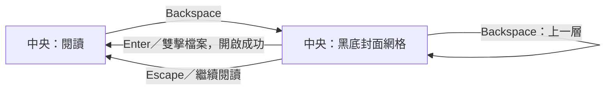

# 整合式中央檔案瀏覽實作計畫

狀態：執行中。使用者已授權原生實作、commit、push 與 pull request；仍不發布套件、建立 tag 或派送 release workflow。分支為 `narumi/feat/integrated-file-browser`，基底為 `1534c3e`。

## Goal

將 [整合版 HTML](../file-browser-concepts/04-integrated.html) 的核心操作實作於原生 GPUI：**保留上方選單／工具列、左右面板與底部狀態列，只切換中央閱讀畫面與黑底封面網格。**

- 閱讀中按 Backspace，顯示檔案瀏覽；不關閉目前書籍，不新增視窗或模態覆蓋層。
- 瀏覽中可搜尋、排序、選取、進入資料夾及開書；返回時保留原閱讀位置與瀏覽狀態。
- 保留既有單頁、雙頁、連續閱讀、縮放、影像調整、Preferences、檔案拖放與外部開書能力。

## Context

以目前 `1534c3e` 的原始碼為依據；實作前重新記錄 HEAD 與工作目錄差異，不覆寫既有原型或使用者修改。

| 現有位置 | 已確認行為／實作影響 |
| --- | --- |
| `src/ui.rs::render_workspace` | `h_resizable` 已保留左右面板狀態，但中央固定呼叫 `render_viewer`；應只替換這一個內容插槽。 |
| `ReaderView::browse`、`render_files`、`file_entry` | 已有非同步目錄列舉與左側清單；目前沒有中央網格、選取模型、搜尋或排序控制。避免建立兩份不同步的目錄資料。 |
| `ReaderView::open_path`、`open_revision`、`listing_revision` | 已有過期結果保護；成功開書才替換 `Reader.book`。新模式必須與這些生命週期整合。 |
| `ReaderView::tick`、`load_requested` | 會推進投影片、依連續閱讀捲動位置更新目前頁，並載入閱讀圖片；瀏覽時必須避免這些路徑改動保留的閱讀位置。 |
| `bind_commands`、`perform`、`render_status` | 尚無 Backspace 瀏覽命令。方向鍵目前翻頁；Escape 會處理資訊浮層與全螢幕。不能只停用按鈕而漏掉快捷鍵、原生選單或 Slider 回呼。 |
| `src/book.rs::browse_directory` | 列出第一層支援項目；使用 canonical 路徑、資料夾優先與自然排序。`DirectoryEntry` 尚無日期、大小或頁數。 |
| `Book::open`、`Book::read_page` | 可重用封存檔索引與安全讀取，但索引仍有成本。開啟單張圖片實際會建立父目錄書籍，指定頁由 `initial_page` 決定。 |
| `src/imaging.rs::decode_thumbnail` | 已有保持比例、EXIF 方向與首幀縮圖；不用會解出多幀的 `decode_thumbnail_frames` 製作書庫封面。 |
| `src/settings.rs::AppSettings` | 只有最近開啟路徑、零起算頁碼與書籤，沒有頁數、完成標記或閱讀時間。設定使用 `deny_unknown_fields`。 |
| `src/ui/tests/`、`tests/rendering.rs` | 已有原生事件、焦點、幾何與虛擬化測試。現有 GPU 截圖分支僅在 macOS 執行。HTML 的 387 項檢查不是原生驗證。 |

技術沿用 Rust 1.99.1、GPUI Kit 0.9.0 與既有相依套件。

## Architecture

### 狀態與操作契約



1. 中央模式使用執行期 `ContentMode`，與左側 `SidebarMode` 分開。切換中央模式不得強制改變左右面板顯隱、寬度或目前工具分頁。
2. `Reader`、目前書籍、頁碼、縮放、旋轉、濾鏡與閱讀用捲動狀態繼續存在。
   - 進入瀏覽時暫停投影片；返回後不自動播放。
   - 瀏覽時停用翻頁、閱讀縮放、旋轉及播放命令與控制項，不讓網格滾輪觸發閱讀縮放。
   - 暫停從隱藏的連續閱讀 ListState 推算目前頁；保留頁內捲動錨點。視窗改變後以原頁與頁內位置重新定位，不無條件跳回頁首。
3. 記錄開書來源與瀏覽快照。
   - 從網格開書：成功後進入閱讀；Backspace 返回同一資料夾、搜尋、排序、選取與捲動錨點。
   - CLI、拖放、最近開啟或系統對話框開書：記錄實際要求路徑。首次返回瀏覽時，顯示該項目的父目錄並選中來源項目；不要把圖片的父目錄 `Book.path` 誤當成原圖片。
   - 「閱讀目前資料夾」保留原瀏覽快照，不改成檢視該資料夾的父目錄。
   - 沒有書籍時顯示瀏覽；沿用目前 home 起始目錄。無書籍可返回時，繼續閱讀停用、Escape 不切換畫面。
4. 網格單擊選取；Enter／雙擊資料夾只進入目錄，Enter／雙擊檔案沿用開書流程。閱讀資料夾沿用明確的「開啟目前資料夾」動作。
   - 瀏覽中的 Backspace 回到實際檔案系統上一層；檔案系統根目錄無動作，不套用 HTML 的示範根目錄限制。
   - 輸入欄位、IME 組字、Dialog、Popover 與面板拖曳期間不得被瀏覽快捷鍵攔截。
   - Escape 先由作用中的 Dialog／Popover 處理，再關閉應用程式浮層，再從瀏覽恢復閱讀，最後才沿用退出全螢幕行為。
5. 以原生項目身分保留選取與捲動錨點，不以排序索引或顯示字串識別。
   - 保留來源項目路徑與 canonical 讀取目標的差別，避免兩個 symbolic link 指向相同目標時產生重複 UI ID。
   - 目錄切換只記錄輕量導航快照，不保留每層完整 Book、目錄清單與封面。
   - 開啟失敗保留原書與瀏覽狀態；刪除、權限或列舉錯誤提供訊息與重試。
6. 非同步結果同時受請求世代與最新操作意圖限制。切換目錄、刷新、關閉、再開書或恢復舊書後，過期結果不得替換新畫面。
   - 世代檢查只拒絕結果，不宣稱已中止同步封存檔解壓；停止派發過期佇列，限制仍在執行的工作數。

### 排序與資料規則

本次不新增設定 schema、資料庫、檔案監看或背景書庫掃描。瀏覽偏好與已知頁數只保留於視窗生命週期；既有閱讀紀錄照原流程保存。

| 選項 | 本次原生語意 |
| --- | --- |
| 名稱：自然 | 沿用 `natord::compare_ignore_case`，再以原名稱與原生路徑決定同值順序。 |
| 名稱：文字 | 明確使用文字比較，不做數字自然排序；不宣稱與瀏覽器的 locale collation 完全相同。 |
| 修改日期／建立日期 | 從列舉時已有的 `Metadata` 取得 `Option<SystemTime>`；不支援建立時間時保留未知，不以修改時間冒充。 |
| 檔案大小 | 一般檔案長度；封存檔為壓縮檔本身大小。資料夾不遞迴加總，大小不適用。 |
| 類型 | 先依資料夾／封存檔／圖片類別，再依小寫副檔名；資料夾優先仍由獨立核取方塊控制。 |
| 頁數：已知 | 使用目前已開書籍或可見封面索引取得的頁數；圖片項目為 1。未知顯示「—」，不為排序額外開啟所有封存檔。 |
| 閱讀進度：已知 | 僅在有相符書籍身分的保存頁碼及有效總頁數時比較未四捨五入的比例；先依總頁數限制索引，顯示採目前狀態列的 `(page + 1) / count`。未開啟不等於第 0 頁；沒有足夠資料顯示「—」，不推定已讀完。停用記住位置時不藉由瀏覽更新保存頁碼。 |
| 最近開啟 | 使用現有 `recent` 的有限順序，清楚標為「最近開啟」，不把它冒稱為最後閱讀時間；不在清單內者為未知。 |
| 隨機 | 每次列舉或明確洗牌建立固定亂序鍵；重繪、選取與模式切換不重新洗牌。升降冪作用於同一組鍵。 |

- 升降冪不改變資料夾優先分組；未知值在同組內永遠置後。同值使用固定的名稱／路徑順序。
- 頁數與進度選項須標明「已知」，並顯示資料未齊全的說明。封面索引補齊資料時不自動重新排列；使用者重新套用排序才採用新資料，保持選取與畫面穩定。
- 資料夾頁數只接受與實際開書遞迴設定相符的結果。單張圖片項目不套用整個父目錄的閱讀百分比。
- 檔案瀏覽排序絕不改變 `Book.pages` 的閱讀順序。

### 封面載入與檔案界線

- 圖片：以受 `MAX_PAGE_BYTES` 與 bounded read 保護的單檔讀取取得該圖片，不用 `Book::open(image)` 掃描父目錄。
- 封存檔：僅對可見項目索引，取自然排序的第 0 頁並解出靜態縮圖；保留目前 ZIP／RAR 的加密、大小、CRC 與來源變更檢查。
  - 現有 `Book::open` 沒有總索引筆數／中繼資料量上限，不可無條件作為自動封面的入口。先驗證底層索引 API，再在封面專用讀取路徑限制來源與索引工作量；不改變使用者明確開書的既有語意。
  - 超限或無法在大量配置前實施限制的來源，顯示格式圖示與原因，不啟動無界索引。這個降級行為須列入測試與使用說明。
- 資料夾：本次封面只取**第一層**自然排序的第一張支援圖片，不遞迴搜尋，也不開啟內含封存檔。沒有直接圖片時顯示資料夾圖示。
  - 此封面規則不變更實際開書的 `recursive_folder` 設定，也不把第一層圖片數當成遞迴書籍頁數。
- 第一張無法讀取或解碼時顯示替代圖示與錯誤提示，不逐頁尋找替代封面。
- 僅請求可見列與前後各一列；讀取、索引與解碼不得在 render 或 UI 執行緒進行。
- 同時最多 2 個封面工作；不要和閱讀載入器形成無上限的獨立工作池。瀏覽期間停止派發不需要的閱讀預載。
- 使用獨立、有固定 byte 預算的封面快取，不共用目前以頁碼為鍵的閱讀快取。
  - 鍵包含 canonical 來源、封面尺寸／顯示比例及來源指紋；排序後不得把舊封面貼到別的項目。
  - 檔案長度／mtime 是失效提示，不是完整內容版本。資料夾 mtime 不保證反映子圖片變更；明確刷新必須使相關封面、失敗記錄與已知頁數失效。
  - 失敗先快取至刷新或來源失效，避免每次重繪都重試。淘汰時沿用原生 image release 機制；不寫入來源檔案或磁碟封面快取。

### 修改位置

| 位置 | 責任 |
| --- | --- |
| 新增 `src/browser.rs`，由 `src/lib.rs` 宣告 | 不依賴 GPUI 的排序、篩選、項目身分、已知資料與導航快照模型；可獨立單元測試。 |
| `src/book.rs` | 擴充列舉時的 optional metadata，提供有界單檔讀取與明確的封面來源選擇；保留原開書行為。 |
| 新增 `src/ui/browser.rs` | 中央網格、瀏覽控制、可見列與封面請求／快取的 GPUI 實作；不要建立通用任務框架。 |
| `src/ui.rs` | 保留視窗與面板所有權，接上中央模式、開書成功／失敗、命令與 tick 防護。 |
| `src/i18n.rs` | 一次補齊 English、Japanese、Traditional Chinese 的新文字、提示、角色與可及性名稱。 |
| 新增 `src/ui/tests/browser.rs`；擴充 `tests/rendering.rs` | 原生事件、幾何、生命週期與大目錄虛擬化驗證。 |

## Plan

依序執行；每一項的驗證通過後才勾選。依使用者最新授權執行實作與 PR 交付。

- [x] **1. 建立原生基線。** 乾淨 detached worktree 的 fmt、Clippy、原生 rendering 通過；全量 185 passed／1 既有 IPC queue ConnectionReset 失敗，記錄於 `target/integrated-browser-baseline/clean-*.log`。已確認 GPUI API 與 native PATH；自動 ZIP 封面採來源 64 MiB、4096 項、2 MiB metadata 預檢，RAR／ZIP64／超限格式使用圖示降級。
  原任務： 記錄 HEAD、工作目錄、Rust／平台版本；執行下方既有品質命令並保存結果。確認 GPUI 0.9.0 的網格列虛擬化、Input／Popover 焦點、雙擊與縮放比例 API，以及 ZIP／RAR 封面索引能否在大量配置前施加限制。驗收：有基線與 API 路徑記錄；逐格式記錄可安全自動取封面或使用圖示的決定；無未處理的必要環境依賴。
- [x] **2. 建立瀏覽資料模型。** 模型 16 項測試與 47 項書籍／封面測試已通過。
  原任務： 新增 `src/browser.rs`，補齊列舉 metadata、10 個排序選項、搜尋、固定隨機鍵、選取與輕量導航快照。驗收：自然／文字、缺值、同值、升降冪、資料夾分組、symbolic link 身分及原生路徑單元測試通過；排序不讀取封存檔內容。
- [x] **3. 實作中央模式與生命週期。** 原生模式、輸入、遲到結果與獨立審查發現的生命週期問題均有回歸測試。
  原任務： 在 `ReaderView` 接上模式、開書來源、返回快照、暫停播放、隱藏閱讀 tick 與最新操作意圖保護。驗收：無新視窗／覆蓋層；閱讀位置與既有 Book 不因切換而重設；開書失敗、延遲結果、外部開書及關閉後結果測試通過。
- [x] **4. 建立中央虛擬網格。** 10,000 筆虛擬化與遠距捲動測試通過。
  原任務： 在原 `render_workspace` 的中央插槽接上網格，沿用左右面板 entity 與寬度。加入路徑、搜尋、排序、升降冪、資料夾優先、洗牌、刷新與開啟選取。驗收：單擊選取、Enter／雙擊開啟、上一層、空目錄／無結果／錯誤均可用；10,000 筆合成項目仍只建立可見列加前後各一列，不建立 10,000 個 tile。
- [x] **5. 接上懶載入封面。** 已驗證來源上限、兩工作限制、alias 共用工作、32 MiB 淘汰、刷新／關閉後 atlas 釋放。
  原任務： 補上安全來源讀取、封面專用索引限制與超限降級、靜態縮圖、可見請求、最多 2 個工作、有界快取、失敗快取、刷新與原生 image release。驗收：單張圖片不錯取父目錄第 0 頁；封存檔採自然順序；淺層資料夾規則、損壞／加密／超限來源、過期結果、排序後封面身分與 GPU 資源釋放測試通過。以計數器證明沒有全目錄解碼或因排序而全量索引。
- [x] **6. 整合原生控制與快捷鍵。** 三語、Input／Popup／拖曳、原生控制及舊閱讀測試通過；不修改 IPC 測試。
  原任務： 加入 Backspace、網格方向鍵、Home／End、Enter、Escape 與上方模式入口；右側新增瀏覽工具，提供封面尺寸、檔名顯示／行數與資訊顯示，不移走原有閱讀／播放工具。驗收：滑鼠、鍵盤、原生選單與 Slider 具有一致模式防護；Input、Popover、Preferences、拖曳及閱讀快捷鍵回歸測試通過；三語文字完整。
- [x] **7. 完成原生版面與狀態回歸。** Windows 與 Linux rendering 通過；三語、三尺寸、四種側欄組合的中央切換與工具捲動可達性已驗證。
  原任務： 在三語、1280×800、960×640、800×540、不同面板顯隱與寬度下測試。驗收：同尺寸切換前後，工具列、左右面板及狀態列 bounds 不變；中央控制不重疊；改變欄數／縮圖尺寸仍以項目錨點還原；保留精確頁碼、閱讀頁內捲動、縮放與瀏覽狀態；瀏覽背景不受閱讀濾鏡污染。
- [ ] **8. 執行品質檢查並交付證據。** 重跑下方品質命令；更新 `docs/verification.md` 與必要的使用說明，記錄實際平台、測試、原生幾何／可取得的截圖及限制。驗收：必要檢查通過或有明確授權例外；只含本功能修改，無新增相依套件、設定 schema 或來源圖片改寫。保留 External Handoff 後，才可在實作完成時刪除此計畫。

### 品質命令

在原生 Rust 終端機執行，使用 repository 指定的 toolchain：

```text
cargo fmt --all -- --check
cargo test --locked --all-features
cargo test --locked --test rendering
cargo clippy --locked --all-targets --all-features -- -D warnings
git diff --check
```

- 模型與 UI 工作可先用 `cargo test --locked --all-features browser::tests` 及 `cargo test --locked --all-features ui::tests::browser::` 做局部檢查；不能取代全量命令。
- `tests/rendering.rs` 設定 `test = false`，必須明確執行；不要假設全量測試已包含它。
- 本機 WSL 目前可找到的是 Windows `cargo.exe`；使用原生 Windows 工具鏈與可找到 rustfmt／Clippy 的子程序 PATH，不把它記成 Linux 驗證。由 WSL 呼叫 Windows 程式時關閉 stdin，避免讀走後續 shell 指令。
- 既有驗證文件記錄過 IPC 並行失敗；實作時重新建立當前基線。若再失敗，保存失敗名稱與基線對照，不隱藏測試，不以 serial pass 冒充正常並行 pass。必要檢查未通過且無授權例外時，完成清單保持未完成。

## Completion Checklist

- [x] Backspace 只替換中央內容；相同尺寸的外框 bounds 不變，沒有新視窗或浮層。
- [x] 瀏覽的選取、搜尋、排序、捲動，以及保留書籍的頁碼、縮放、濾鏡與頁內位置可恢復。
- [x] 輸入編輯與浮層焦點安全；瀏覽時不會因快捷鍵、原生選單、計時器或滾輪暗中翻頁、縮放或播放。
- [x] 10 個排序選項符合已定義語意；未知頁數／進度及有限最近開啟紀錄不被假造為完整書庫資料。
- [x] 大目錄只渲染可見列；封面工作與快取有界，來源讀取沿用安全限制，過期結果與原生資源釋放均有測試。
- [ ] 全量 Rust、原生 rendering、Clippy、格式與 diff 檢查具有實際結果；HTML 測試不作為原生完成證據。
- [ ] 已更新驗證紀錄與必要說明，保留未驗證平台／主觀檢視交接；沒有修改使用者漫畫、設定 schema 或無關功能。

## Risks

- 來源解碼仍受既有 128 MiB encoded input、32 Mi pixels 等限制；這些限制不代表書籍索引本身有界。Solid RAR 的第一張閱讀頁也可能位於壓縮串流後段。第 1、5 步須證明自動封面路徑的索引／解壓界線，不能以「在背景執行」或「只有兩個工作」冒充每個工作的安全上限；不能安全處理時使用圖示。
- 已知頁數／進度排序不是完整書庫索引；必須保留可見提示，不能在實作完成後宣稱所有未開啟書籍都能按完整百分比排序。
- 視窗縮放、側欄拖曳與非同步結果會改變網格欄數及項目位置；必須使用項目／頁內錨點還原，而不是照抄像素 offset。

## Non-Goals

不實作獨立書庫首頁、覆蓋式書架、持久封面資料庫、全書庫頁數索引、最後閱讀時間追蹤、已讀完成標記、閱讀頁面重排、全新縮放演算法或自動更新／安裝包變更。不把 HTML 的靜態閱讀控制當作需要重寫的原生功能。

## External Handoff

- **產品維護者：** 取得原生閱讀／瀏覽幾何證據與可取得的截圖後，比較參考圖的封面密度、文字可讀性與操作舒適度。主觀接受度未由自動化證明；不要求等待此回覆才完成代理可做的工作，也不據此宣稱產品已驗收。
- **平台維護者：** 在實際可用的 Windows／macOS 桌面與目標顯示縮放下，檢查 OS 鍵盤、IME、焦點、字型及高 DPI 封面。既有 `tests/rendering.rs` 的 Windows 路徑可驗證事件與幾何，但不產生 macOS Metal 截圖。代理能在本機或既有可存取 runner 執行的自動化檢查仍須執行，不能移作人工交接。
- **發布限制：** 使用者已授權 commit、push 與 PR；仍不發布套件、建立 tag 或派送 release workflow。沒有對應平台的執行證據時，不宣稱該平台 runtime／視覺已驗證；原有 CI 與發布要求不因本計畫而放寬。實作完成後將尚未驗證事項保留於 `docs/verification.md`，再刪除已完成的執行計畫。
