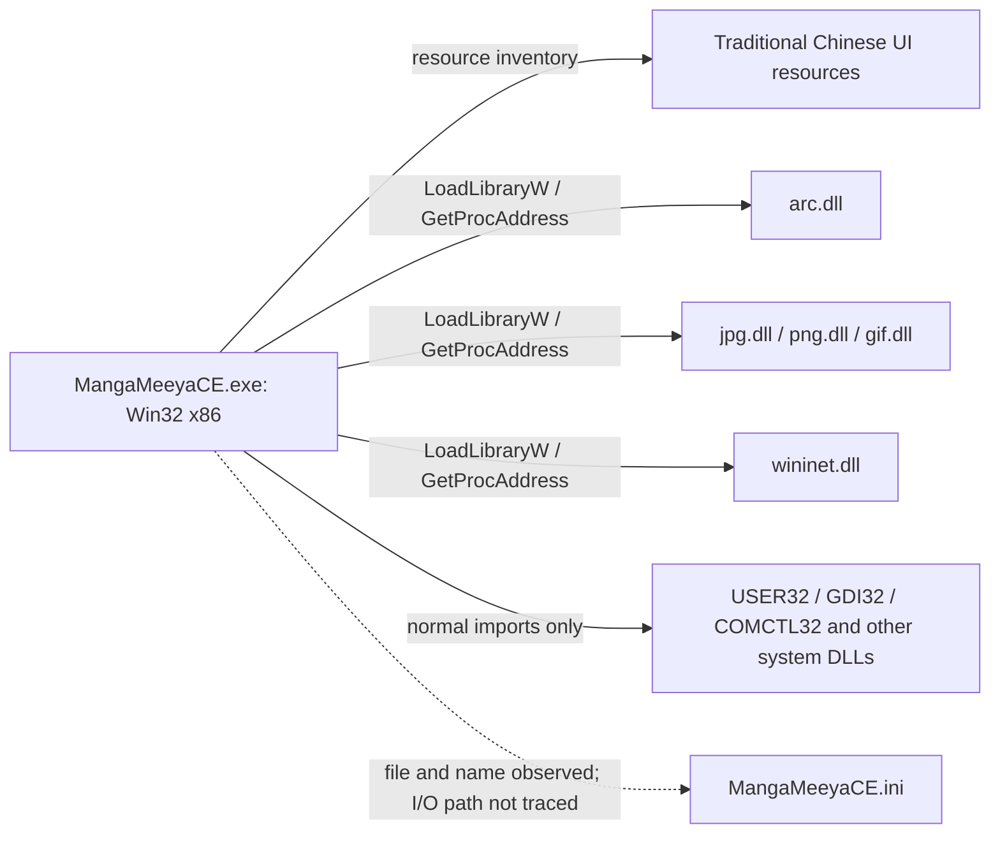

# MangaMeeyaCE static investigation

Date: 2026-11-08

Target: `D:\Program files\MangaMeeyaCE`

Status: **Initial static analysis complete; full native analysis blocked.**

## Summary

The selected application identifies itself as **MangaMeeyaCE v2.4Beta**. It is a native x86 Win32 GUI application with Traditional Chinese resources and separate archive, JPEG, PNG and GIF modules.

REA established the identities and resource inventories of the executable and four DLLs. Supplemental byte parsing and GNU objdump established selected loader code paths, DLL exports and current numeric settings. These supplemental results are **not REA Evidence**.

The target was not executed. No installation file, application setting, client configuration or source file was changed. No thumbnail-cache file was opened. No recent-file path, bookmark target or password was retained.

## Evidence index

REA version: `6.7.0`. Full records and two residual unknowns are in [rea-bundle.json](evidence/rea-bundle.json).

| Ref | REA operation and target | Evidence ID |
| --- | --- | --- |
| R1 | `inspect_pe_resources`, `MangaMeeyaCE.exe` | `ev_e7f7c96250be071345eb16e8f06ed56dbf3809653c0363021d39f4621c47787c` |
| R2 | `inspect_pe_resources`, `arc.dll` | `ev_49d4b275bfe05cab9c7a4a20731fb159926efdaea2b4869b31cd5cb2aed3dd3b` |
| R3 | `inspect_pe_resources`, `gif.dll` | `ev_d9ecd358fe416020fb8e9c46f4af3cc6885c790fa37194bf6b0484837d50f5c8` |
| R4 | `inspect_pe_resources`, `jpg.dll` | `ev_390623189cf4b0cc636186f832d75f313d789faaf10f03d96e13d96a41099229` |
| R5 | `inspect_pe_resources`, `png.dll` | `ev_24dee97dd17513a2a2c7dfc0a76057a92dc9cff78375453743cfd10c20e12ff4` |

Supplemental observations:

- **S1:** [decoded-resources.json](evidence/decoded-resources.json). Win32 resource decoding. The source and each payload hash were checked against R1. REA itself treats these payloads as opaque.
- **S2:** [supplemental-pe.json](evidence/supplemental-pe.json). Executable headers, normal imports, literal candidates, root-file hashes and toolbar bitmap headers.
- **S3:** [supplemental-ancillary.json](evidence/supplemental-ancillary.json). DLL exports, version bytes, initial DLL-name pointer slots and 104 allowlisted numeric INI settings.
- **S4:** [supplemental-assembly.txt](evidence/supplemental-assembly.txt). Bounded GNU objdump 2.46 disassembly. This is not a recovered complete call graph or original source.
- **S5:** [rea-status.json](evidence/rea-status.json). Provider diagnostics and the unsuccessful REA objdump attempt. This file is diagnostic context, not an Evidence record.
- **V1:** [validation.json](evidence/validation.json). Final identity, resource, reference and output checks.

## Target identity

| File | Bytes | SHA-256 |
| --- | ---: | --- |
| `MangaMeeyaCE.exe` | 708,608 | `ec0b517af2813c841d350a95080725d8842e8fdf4eb7f1590c9027466b55e530` |
| `arc.dll` | 237,568 | `926aa3f83797d5bb9a810f17fc4d3c897b2ccabc4dc6b0867b34c39edabd73fb` |
| `gif.dll` | 94,208 | `02d68a67e66968223e0c95788ef3a14e207ac538200a7219fbacb4a712d50cea` |
| `jpg.dll` | 811,008 | `fede07b96792f8efec6342cfa0ae493e0a8be061e8837e81ea475ebdb3cc824f` |
| `png.dll` | 212,992 | `a828b3299f18eff8d442babe8b81510df332c39e1c5da89a19757ee9417fc133` |

All five images are PE32 x86. The executable has image base `0x400000`, entry RVA `0x79c00`, and preferred entry VA `0x479c00`. Its CLR directory is zero. The isolated `mscoree.dll` literal is not evidence of a managed application. The COFF header claims `2006-06-02T11:53:13Z` and linker version `8.0`; these do not authenticate the build date or compiler. [R1–R5, S2, S3]

The version text is string-resource ID **400**, at file offset **`0xa7918`**. The executable has no RT_VERSION resource. All 90 executable resources use language ID **1028 / `0x0404`**. This establishes the stored resource language, not language-switching behavior. [R1, S1]

The directory has nine root files: five PE images, one INI and three toolbar bitmaps. The bitmaps are 8-bit images of `160×320`, `200×400` and `280×560` pixels. Only cache-directory names and file metadata were enumerated; no cache contents were inspected or copied. [S2]

## Static architecture

The diagram describes static relationships, not observed execution. The normal import table has **260 functions across seven DLLs**: `KERNEL32`, `USER32`, `GDI32`, `comdlg32`, `SHELL32`, `ole32` and `COMCTL32`. Image modules and WinInet are resolved separately. A normal-import-only analysis would miss these dependencies. GDI imports include `CreateDIBSection`, `BitBlt`, `StretchBlt` and `StretchDIBits`; the complete rendering path remains unknown. [S2, S4]

### Selected loader paths

All executable addresses below are preferred VAs, not file offsets.

| Path | Static observations | Boundary |
| --- | --- | --- |
| Archive loader, seed `0x404400` | `0x404464` reads slot `0x49d080`, whose initial pointer names `arc.dll`. `0x40446a` calls `LoadLibraryW`. The following code resolves `ArcGetVersion`, archive open/close, file information, decode streams, password and writer functions. `0x40456d` checks version code `0x12`. | Only the retained code window was inspected. Format coverage and runtime loading were not established. |
| Image loader, seed `0x445610` | `0x445683` selects an initial DLL-name table at `0x49e668`: JPEG, PNG, GIF. `0x44568b` calls `LoadLibraryW`. PNG/GIF branches check `GetDllVersion == 0x0b`. The JPEG branch resolves IJL functions and checks version-structure fields `2` and `5`. | Initial file-backed pointer values are not observed runtime state. Complete decode and filter paths were not traced. |
| WinInet loader, seed `0x430740` | `0x430765` loads `wininet.dll`. The code resolves `InternetOpenW`, `InternetOpenUrlW`, `HttpQueryInfoW`, `InternetCloseHandle` and `InternetReadFile`, then checks the pointers. Calls through those slots occur at `0x4311e4`, `0x430086`, `0x431216`, `0x42fc59` and `0x42fdd1`. | This establishes network-capable code, not a connection, destination, supported protocol set or current service availability. |

These paths use IAT slots `0x48b200` (`LoadLibraryW`) and `0x48b204` (`GetProcAddress`). [S2–S4]

## Feature surface

R1 contains **35 dialog templates, 49 string-table blocks, two menus, one accelerator table, one icon, one icon group and one manifest**. S1 decoded all 88 non-icon resources with no parser failures or unconsumed bytes. The string tables contain **663 nonempty strings**.

The following are **stored UI declarations and help text**, not proof that every command works.

| Area | Declared controls or behavior | Resource anchors in S1 |
| --- | --- | --- |
| Reading layouts | Single page, two-page spread, left/right binding, automatic spread, horizontal/vertical page splitting, blank cover page, magnifier and fullscreen | Strings `541–567`, help `2041–2067`; dialogs `485`, `496` |
| Automatic layout | Separate aspect-ratio thresholds and overlap margins for spread and split conditions | Dialog `496`; decision code not recovered |
| Navigation | Spread-sized next/previous movement versus one-page movement; configurable jumps; next/previous folder or archive; forward/reverse slideshow; loop modes | Strings `591–618`, help `2091–2118`; dialog `502` |
| View modes | Reader, thumbnail sheet and file-browser modes | Strings `558–564`, help `2058–2064`; dialogs `478`, `482` |
| Scaling | Fixed scale, fit variants, original size, equal-height spread, custom scale/width/height, and no-upscale option | Strings `571–579`; dialog `483` |
| Resampling | Nearest pixel, HALFTONE, average pixel, Lanczos3, cubic interpolation, linear interpolation, average pixel with weak/strong sharpening | Strings `581–589`; dialog `504` |
| Image processing | Rotation, automatic rotation, clipping/margins, brightness, contrast, gamma, tone-curve points, sharpening and resize settings | Dialogs `497–500`, `504` |
| Performance | Separate image/file caches, preload, resized-image cache, cache information and page-transition effects | Strings `671–673`; dialogs `480`, `484` |
| Input and workspace | Keyboard remapping, repeat suppression, mouse buttons/wheel, touch regions, gestures, four toolbar definitions, docked/floating/popup panels and detached tabs | Menus `302`, accelerator table `250`; dialogs `488–494`, `506` |
| Save and file operations | Original-data and converted-image save options; JPEG/PNG/GIF/BMP; grayscale, JPEG quality/subsampling/Exif, PNG compression; copy/move/delete/rename and extraction entries | Menu `460`; dialog `503`; strings `2035–2036` |
| State | History, ten INI profile slots, folder bookmarks and a separate page-marker command | Strings `509–537`, help `2031–2037`; INI section names |
| Other entry points | URL open, archive password prompt, text layout with vertical/horizontal direction and ruby controls | Dialogs `505`, `509`, `508` |

Do not equate the thumbnail sheet with a modern vertical continuous-reader mode. The inspected resources do not establish such a layout. Also, help text describes folder bookmarks separately from page markers; it does not establish per-book resume semantics.

`pdf.dll`, `jp2.dll` and `res_lang.dll` occur as literals but are not bundled in the selected directory. The PDF loader has controls in dialog `507`. These facts do not establish successful loading through another search location. [S1, S2]

## DLL interface findings

S3 records all **41 named exports** with RVAs, ordinals and file offsets. Each DLL has only `KERNEL32.dll` in its normal import table; dynamic dependencies remain possible.

| DLL | Named exports | Interface observations | Version observations |
| --- | ---: | --- | --- |
| `arc.dll` | 13 | `ArcOpen`, `ArcGetFileInfo`, `ArcGetDecodeStream`, `ArcExtractFile`, `ArcSetPassword`, comment and writer functions | `ArcGetVersion` returns `0x12`, matching the inspected executable check. Embedded zlib banners say `1.2.1`, while another string says `1.2.3`; one unqualified library version is not justified. |
| `gif.dll` | 12 | Picture inspection/loading plus `GifOpen`, `GifGetFrameNum`, `GifGetDelayTime`, `GifAddFrame` and writer functions | `GetDllVersion` returns `0x0b`. Export names suggest frame/timing support; actual animation behavior was not observed. |
| `jpg.dll` | 11 | `ijlInit`, `ijlRead`, `ijlWrite`, `ijlFree`, `ijlGetLibVersion`, plus picture/plugin entry points | Returned version structure starts `2,5,15`; nearby strings say `ijl20l.lib`, `2.5.15` and `[2.5.15.47]`. Its separate PE file/product version is `1.0.0.0`. |
| `png.dll` | 5 | `CheckPicture`, `LoadPictureInfo`, `LoadPicture`, `SavePicture`, `GetDllVersion` | API code `0x0b`; embedded strings name libpng `1.2.8` and zlib `1.2.3`. These are artifact claims. |

The archive interface and password dialog do not prove support for a particular encryption scheme. ZIP/RAR format coverage was not established. The inspected `CheckArchive` export delegates detection to other routines, which were not traced. [R2–R5, S1, S3, S4]

## Current settings, not defaults

`MangaMeeyaCE.ini` is 12,164 bytes, with a UTF-16LE BOM and header `;MangaMeeyaCE v2.4Beta`. S3 retains only allowlisted numeric values. All history paths, bookmark targets, save directories and cache paths are omitted.

| Section | Selected saved values |
| --- | --- |
| `Cache` | `PictureCacheSize=20`, `FileCacheSize=1`, `PreLoad=1`, `LoadScaled=1`, `LoadCached=0` |
| `ViewMode` | `PageMode=1`, `AutoPageMode=0`, `BindDir=1`, `DoorPage=0`, `Sort=3` |
| `ScaleMode` | `Mode=6`, `ResizeFilter=3`, `OptionalWidth=1280`, `NoZoomIn=0` |
| `Scroll` | `SmoothScroll=1`, `HorzDistance=50`, `VertDistance=50`, `SmoothScrollAccel=50` |
| `Play` | `Interval=1000`, `Option=0` |
| `General` | `ConfirmDelete=1`, `PageEffect=1`, `PageEffectWait=500`, `PostFilter=0` |
| `Save` | `Original=0`, `JpgQuality=75`, `JpgExif=1`, `PngCompressLevel=9` |

Do not map these numeric enums to UI choices or treat them as factory defaults without tracing the INI readers. UI unit labels alone do not establish the persisted representation. The fixed six-entry accelerator resource also does not establish the user's configurable reader shortcuts.

## Coverage and unresolved work

| Investigation question | Status | Evidence or limit |
| --- | --- | --- |
| Which executable and modules were selected? | Answered | R1–R5, file hashes and PE headers |
| What UI features and settings are declared? | Answered for the inspected resources and selected settings | S1, S3; not a runtime feature audit |
| How are archive/image/network modules loaded? | Partially answered | Selected code windows in S4; no complete graph |
| How do layout, cache, scrolling and filters operate? | Unresolved / blocked | No configured deep native provider |
| Which declared features work on the current host? | Unresolved / not tested | Target execution was outside this static pass |
| What is the `.mmt` cache format? | Unresolved / not inspected | Only literals and directory metadata were inspected |

Retained REA unknowns:

- Native reader state and rendering: `unk_cbf1b85dbb2884eb988c314ad6ad150d20495550f9a5ebb2561f09fc796252a3`.
- Runtime feature availability: `unk_56cf210ae539df1a3ae3cf28d627b8221de6ebbc2ab066d4d240a71a4e2e708a`.

### Provider blocker

`open_binary` succeeded and bound the correct x86 executable, but no deep provider was selected. Ghidra lacks `GHIDRA_INSTALL_DIR` and a usable configured Java path. IDA and Kuna are not configured; Hopper does not support this Windows host. REA `binary_overview`, function analysis, pseudocode, cross-references and bookmarks are therefore unavailable. REA's separate objdump operation also failed with `ERR_REA_WINDOWS_NATIVE`; S4 instead uses the existing WSL objdump and is labelled accordingly. [S5]

No engine was installed and no configuration was repaired. Full function analysis needs a supported, configured provider before it can continue.

### Follow-up order

1. Configure a supported existing native provider, then reuse the target SHA-256 and loader seeds above. Review any configuration writes before applying them.
2. Trace automatic spread/split decisions, page movement, INI enums, cache eviction and filter order from their command handlers and settings readers.
3. If runtime verification is requested, use a disposable application copy and synthetic images/archives. Check feature availability, file writes and network effects without using private caches.

No Rust implementation or feature-parity claim is made by this report.
