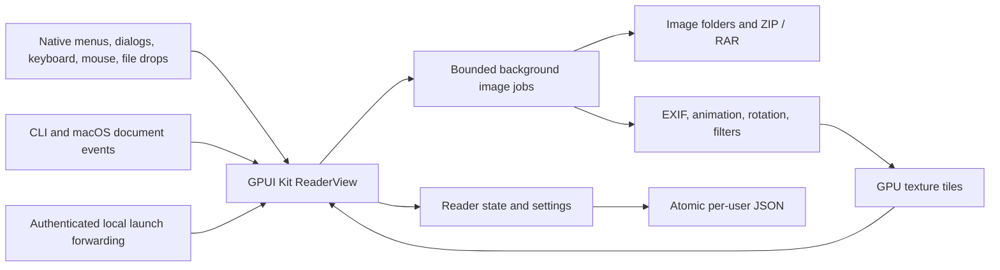

# Native rewrite verification

## Scope

The application uses Rust and GPUI Kit 0.9.0 on Windows and macOS. The former Tauri and TypeScript application, Node dependencies, frontend tests, and WebView configuration are removed.

## Regression coverage

- Book tests cover natural order, selected images, recursive folders, directory links, canonical paths, directory browsing, missing/corrupt/empty archives, supported ZIP compression methods, RAR generations and solid archives, encryption errors, bounded reads, and source-safe export. RAR regressions include a large preceding non-image attachment and the RAR5/RAR7 dictionary memory limit.
- Reader tests cover navigation, reading direction, spreads, mode changes, bookmarks, position restoration, slideshow, fit, rotation, zoom, and continuous scroll anchors.
- Image tests cover actual encoded formats, EXIF orientations, animation timing/compositing, transforms, thumbnails, and allocation limits.
- Settings tests cover defaults, JSON validation, atomic replacement, backup/reset, lossless native paths, legacy UTF-8 JSON, and preservation of corrupt or unsupported data.
- Instance tests use real local sockets and child processes. They cover authentication, queue and message bounds, concurrent primary ownership, stale endpoints, focus messages, native path encoding, and cleanup.
- GPUI tests use the production view and event path. They cover native open/save dialogs, file browsing, history, fullscreen, slideshow, stale book results, launch ordering, image atlas cleanup, continuous scroll remeasurement, mixed page widths, visible-range loading, visible animated thumbnails above the cache budget, cache and atlas cleanup after hiding the sidebar, tiled long pages, native-path settings after book close, safe settings reset, and save ordering.
- The standalone rendering test opens the production view with native text shaping. On macOS it uses Metal, checks decoded page pixels, and saves captures under `target/ui-smoke/`. It does not need screen recording permission.

## Settings path format

UTF-8 paths remain JSON strings. Other paths use a single `{"unix":[u8]}` or `{"windows":[u16]}` object with the original native units. Recent history remains an array. A position or bookmark map stays a JSON object when all keys are UTF-8; otherwise it uses an array of `[path, page]` pairs. Loading accepts both map formats.

Native objects are platform-specific. Unknown tags, invalid units, extra fields, and foreign-platform encodings are errors; loading and saving leave the file unchanged. Older builds cannot read native objects or pair maps. Keep a backup before a downgrade. UTF-8-only saves retain the legacy format.

## Local checks

The verification host is macOS arm64 with Rust 1.99.1 and full Xcode selected through `DEVELOPER_DIR`.

Native rewrite baseline, verified on 2026-11-07 before the unified zoom change:

| Check | Result |
| --- | --- |
| `cargo fmt --all -- --check` | Passed |
| `cargo test --locked --all-features` | 113 passed; no failures or ignored tests |
| `cargo clippy --locked --all-targets --all-features -- -D warnings` | Passed |
| `cargo test --locked --test rendering` | Passed with real Metal pixels and 10 captures |
| Windows MSVC all-target, all-feature Clippy with `-D warnings` | Passed using LLVM resource tools; no manifest bypass |
| Intel macOS `cargo check --locked --all-targets --target x86_64-apple-darwin` | Passed |
| `bash packaging/macos/build.sh aarch64-apple-darwin` | Release app, ZIP, and DMG created; plist, architecture, ad-hoc signature, and DMG checksum checks passed |
| Packaged macOS app launch | One visible native window; the initial image loaded |
| Native macOS document-open event | Selected the second project icon in the existing window |
| Second CLI process | Forwarded an image to the same primary PID without creating another window |
| `git diff --check` and dependency audit | Passed; no Tauri/WebView application dependencies remain |

The rendering workflow verifies actual CBZ extraction and natural order, decoded image colors, spread order, keyboard and pointer input, input focus, page jump, zoom, ordinary and Control-wheel input, continuous navigation, bookmarks, settings, persistence, window-wide OS file drops, errors, close, lossless GPU tiles for long pages, and animated source pixels. Captures are in `target/ui-smoke/01-empty.png` through `10-cbz-natural-order.png`.

Native launch checks used the project's icon files, not user comics. The app was stopped after the check. The tests do not modify comic sources.

macOS output is under `target/release/bundle/macos/aarch64-apple-darwin/`. Windows installer compilation and macOS packaging mechanics were also checked with temporary test payloads, but those checks are not substitutes for the real macOS release build above or for Windows execution.

## Unified zoom control verification

Validated on 2026-11-07 on macOS arm64 with Rust 1.99.1 and `DEVELOPER_DIR=/Applications/Xcode.app/Contents/Developer`.
The implementation is based on `7425e2a`. The unchanged baseline passed 115 tests and the native rendering workflow before implementation.

| Check | Result |
| --- | --- |
| `cargo fmt --all -- --check` | Passed |
| `cargo test --locked --all-features` | 132 passed; no failures or ignored tests |
| `cargo clippy --locked --all-targets --all-features -- -D warnings` | Passed |
| `cargo test --locked --test rendering` | Passed with real Metal pixels, the original 10 captures, and 6 zoom captures |
| Pinned `changenote 0.10.0` `status` | Passed; pending notes produce one patch release plan |
| `CHANGENOTE_BIN="$PWD/target/changenote-cli/bin/changenote" uv run --no-project python -m unittest discover -s tests/release -v` | 15 passed; GitHub upload commands are mocked |
| `git diff --check` | Passed |

The added tests cover the controlled Popover lifecycle and 16 zoom regressions. They check the rendered page bounds against source dimensions, rather than only comparing two scale helpers. Coverage includes:

- Effective scale for single pages, unequal-size RTL/LTR spreads, the last unpaired page, continuous active pages, retained geometry, rotation, missing geometry, and errors.
- Fitted percentages below 1% and outside the manual 10–800% range. The first manual step uses the unrounded fitted scale.
- Fit choices, their accessible pressed state, custom versus original-size 100%, repeated stepper clicks, and existing reader/menu command paths.
- Keyboard activation, Tab navigation, reader-shortcut isolation, fit/zoom shortcuts outside text editing, global close, and Escape before fullscreen exit.
- Draft retention during resize, sidebar/inspector changes, page changes, rotation, and asynchronous geometry updates, including temporarily missing geometry.
- Invalid/non-finite input, repeated `%` suffixes, finite-value clamping, disabled pending controls, and delayed submissions from a closed panel.
- No Control-wheel zoom through an open panel, no zoom from horizontal-only or zero wheel input, and panel dismissal on book close or asynchronous replacement.
- Display-only input synchronization without settings-dirty changes or settings-file writes. Existing paged scroll-bound regressions also pass.

The production rendering workflow checks popup bounds and visible controls at both 1280×800 and 960×640. Captures remain local or in CI artifacts, not tracked source assets:

- `target/ui-smoke/zoom-before.png`: retained baseline toolbar.
- `target/ui-smoke/zoom-closed-{1280x800,960x640}.png`: current fit mode and percentage.
- `target/ui-smoke/zoom-open-{1280x800,960x640}.png`: the fit choices and manual zoom controls.
- `target/ui-smoke/zoom-custom-{1280x800,960x640}.png`: custom 200% after input submission.

The change adds no dependencies, settings migration, persisted zoom value, or image assets. Source comics are not modified. Recovery is a revert of the UI change and its unreleased note; existing settings files need no conversion.
No package was published, version tag created, or release workflow dispatched for this work.
The complete change was reviewed for correctness, security, lifecycle safety, compatibility, regressions, and scope. No material defects remain.
The completed execution plan was `docs/plans/2026-11-07_unified-zoom-control-plan.md`; its external handoff is retained below.

### Retained zoom handoff

- **Product maintainer:** With the before/after captures and the selected proposal, review visual clarity and reading comfort. The expected result is an assessment of discoverability and usability. These subjective properties are not verified by pixel or geometry tests. This review is optional and is not an agent coding gate.
- **Platform maintainer:** With an interactive Windows or Intel macOS desktop at the intended display scaling, inspect text, popup placement, focus restoration, and input behavior. Automated platform CI is separate evidence. These interactive desktop paths are not verified by local macOS arm64 checks. No new release gate is added; do not claim platform-specific visual or runtime verification without the corresponding evidence.

## External platform and release checks

These checks are not represented as local passes:

- **Windows runtime and installer:** A Windows runner or maintainer with the MSVC toolchain, Windows SDK, and NSIS must run the repository workflow or the documented Cargo and installer test commands. The workflow checks silent installation, all 11 Open With associations, unchanged extension defaults, and uninstall. Local Windows cross-checks prove compilation, not native execution. Do not describe a Windows release as runtime-verified until the native checks pass.
- **Intel macOS runtime:** A maintainer with a supported Intel Mac, full Xcode, and Metal-capable GPU, or a suitable Intel macOS runner, must run the native suite and package checks. An arm64-host cross-check does not prove Intel runtime behavior. Do not describe the Intel build as runtime-tested before these checks pass.
- **Signed distribution:** The release account owner must provide Developer ID signing and notarization for a public macOS release, and an appropriate Windows signing certificate if signed Windows distribution is required. Local macOS packages are ad-hoc signed only; do not describe them as notarized or trusted downloads.
- **Subjective visual acceptance:** A maintainer can review the generated captures and native reading workflow on the intended display and input hardware. Automated geometry and pixel checks do not establish personal usability acceptance. This optional product review is not an agent coding gate.

The project does not require credentials, paid services, or changes to comic sources to build or test locally.
