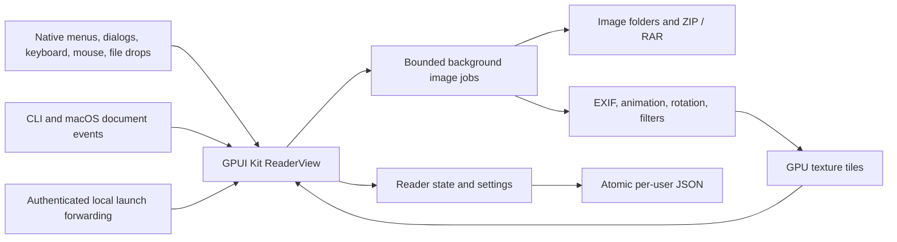

# Native rewrite verification

## Scope

The application uses Rust and GPUI Kit 0.9.0 on Windows and macOS. The former Tauri and TypeScript application, Node dependencies, frontend tests, and WebView configuration are removed.

## Regression coverage

- Book tests cover natural order, selected images, recursive folders, directory links, canonical paths, directory browsing, missing/corrupt/empty archives, supported ZIP compression methods, RAR generations and solid archives, encryption errors, bounded reads, and source-safe export.
- Reader tests cover navigation, reading direction, spreads, mode changes, bookmarks, position restoration, slideshow, fit, rotation, zoom, and continuous scroll anchors.
- Image tests cover actual encoded formats, EXIF orientations, animation timing/compositing, transforms, thumbnails, and allocation limits.
- Settings tests cover defaults, JSON validation, atomic replacement, backup/reset, and preservation of corrupt or unsupported data.
- Instance tests use real local sockets and child processes. They cover authentication, queue and message bounds, concurrent primary ownership, stale endpoints, focus messages, native path encoding, and cleanup.
- GPUI tests use the production view and event path. They cover native open/save dialogs, file browsing, history, fullscreen, slideshow, stale book results, launch ordering, image atlas cleanup, continuous scroll remeasurement, mixed page widths, visible-range loading, thumbnail eviction, tiled long pages, safe settings reset, and save ordering.
- The standalone rendering test opens the production view with native text shaping. On macOS it uses Metal, checks decoded page pixels, and saves captures under `target/ui-smoke/`. It does not need screen recording permission.

## Local checks

The verification host is macOS arm64 with Rust 1.99.1 and full Xcode selected through `DEVELOPER_DIR`.

Verified on 2026-11-07:

| Check | Result |
| --- | --- |
| `cargo fmt --all -- --check` | Passed |
| `cargo test --locked --all-features` | 102 passed; no failures or ignored tests |
| `cargo clippy --locked --all-targets --all-features -- -D warnings` | Passed |
| `cargo test --locked --test rendering` | Passed with real Metal pixels and 10 captures |
| Windows MSVC all-target, all-feature Clippy with `-D warnings` | Passed using LLVM resource tools; no manifest bypass |
| Intel macOS `cargo check --locked --all-targets --target x86_64-apple-darwin` | Passed |
| `bash packaging/macos/build.sh aarch64-apple-darwin` | Release app, ZIP, and DMG created; plist, architecture, ad-hoc signature, and DMG checksum checks passed |
| Packaged macOS app launch | One visible native window; the initial image loaded |
| Native macOS document-open event | Selected the second project icon in the existing window |
| Second CLI process | Forwarded an image to the same primary PID without creating another window |
| `git diff --check` and dependency audit | Passed; no Tauri/WebView application dependencies remain |

The rendering workflow verifies actual CBZ extraction and natural order, decoded image colors, spread order, keyboard and pointer input, input focus, page jump, zoom, ordinary and Control-wheel input, continuous navigation, bookmarks, settings, persistence, window-wide OS file drops, errors, close, lossless GPU tiles for long pages, and animated source pixels. Captures are in `target/ui-smoke/01-empty.png` through `10-cbz-natural-order.png`.

Native launch checks used the project's icon files, not user comics. The app was stopped after the check. The tests do not modify comic sources.

macOS output is under `target/release/bundle/macos/aarch64-apple-darwin/`. Windows installer compilation and macOS packaging mechanics were also checked with temporary test payloads, but those checks are not substitutes for the real macOS release build above or for Windows execution.

## External platform and release checks

These checks are not represented as local passes:

- **Windows runtime and installer:** A Windows runner or maintainer with the MSVC toolchain, Windows SDK, and NSIS must run the repository workflow or the documented Cargo and installer test commands. The workflow checks silent installation, all 11 Open With associations, unchanged extension defaults, and uninstall. Local Windows cross-checks prove compilation, not native execution. Do not describe a Windows release as runtime-verified until the native checks pass.
- **Intel macOS runtime:** A maintainer with a supported Intel Mac, full Xcode, and Metal-capable GPU, or a suitable Intel macOS runner, must run the native suite and package checks. An arm64-host cross-check does not prove Intel runtime behavior. Do not describe the Intel build as runtime-tested before these checks pass.
- **Signed distribution:** The release account owner must provide Developer ID signing and notarization for a public macOS release, and an appropriate Windows signing certificate if signed Windows distribution is required. Local macOS packages are ad-hoc signed only; do not describe them as notarized or trusted downloads.
- **Subjective visual acceptance:** A maintainer can review the generated captures and native reading workflow on the intended display and input hardware. Automated geometry and pixel checks do not establish personal usability acceptance. This optional product review is not an agent coding gate.

The project does not require credentials, paid services, or changes to comic sources to build or test locally.
