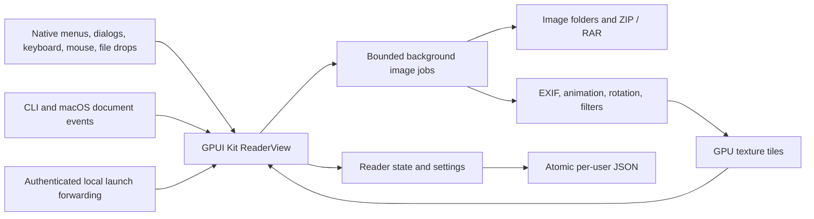

# Native rewrite verification

## Scope

The application uses Rust and GPUI Kit 0.9.0 on Windows and macOS. The former Tauri and TypeScript application, Node dependencies, frontend tests, and WebView configuration are removed.

## Regression coverage

- Book tests cover natural order, selected images, recursive folders, directory links, canonical paths, directory browsing, missing/corrupt/empty archives, supported ZIP compression methods, RAR generations and solid archives, encryption errors, bounded reads, and source-safe export. RAR regressions include a large preceding non-image attachment and the RAR5/RAR7 dictionary memory limit.
- Reader tests cover navigation, reading direction, spreads, mode changes, bookmarks, position restoration, slideshow, fit, rotation, zoom, and continuous scroll anchors.
- Image tests cover actual encoded formats, EXIF orientations, animation timing/compositing, transforms, thumbnails, and allocation limits.
- Settings tests cover defaults, JSON validation, atomic replacement, backup/reset, lossless native paths, legacy UTF-8 JSON, and preservation of corrupt or unsupported data.
- Instance tests use real local sockets and child processes. They cover authentication, queue and message bounds, concurrent primary ownership, stale endpoints, focus messages, native path encoding, and cleanup.
- GPUI tests use the production view and event path. They cover native open/save dialogs, file browsing, history, fullscreen, slideshow, stale book results, launch ordering, image atlas cleanup, continuous scroll remeasurement, mixed page widths, visible-range loading, visible animated thumbnails above the cache budget, cache and atlas cleanup after hiding the sidebar, tiled long pages, native-path settings after book close, safe settings reset, and save ordering.
- The standalone rendering test opens the production view with native text shaping. On macOS it uses Metal, checks decoded page pixels, and saves captures under `target/ui-smoke/`. It does not need screen recording permission.

## Settings path format

UTF-8 paths remain JSON strings. Other paths use a single `{"unix":[u8]}` or `{"windows":[u16]}` object with the original native units. Recent history remains an array. A position or bookmark map stays a JSON object when all keys are UTF-8; otherwise it uses an array of `[path, page]` pairs. Loading accepts both map formats.

Native objects are platform-specific. Unknown tags, invalid units, extra fields, and foreign-platform encodings are errors; loading and saving leave the file unchanged. Older builds cannot read native objects or pair maps. Keep a backup before a downgrade. UTF-8-only saves retain the legacy format.

## Local checks

The verification host is macOS arm64 with Rust 1.99.1 and full Xcode selected through `DEVELOPER_DIR`.

Native rewrite baseline, verified on 2026-11-07 before the unified zoom change:

| Check | Result |
| --- | --- |
| `cargo fmt --all -- --check` | Passed |
| `cargo test --locked --all-features` | 113 passed; no failures or ignored tests |
| `cargo clippy --locked --all-targets --all-features -- -D warnings` | Passed |
| `cargo test --locked --test rendering` | Passed with real Metal pixels and 10 captures |
| Windows MSVC all-target, all-feature Clippy with `-D warnings` | Passed using LLVM resource tools; no manifest bypass |
| Intel macOS `cargo check --locked --all-targets --target x86_64-apple-darwin` | Passed |
| `bash packaging/macos/build.sh aarch64-apple-darwin` | Release app, ZIP, and DMG created; plist, architecture, ad-hoc signature, and DMG checksum checks passed |
| Packaged macOS app launch | One visible native window; the initial image loaded |
| Native macOS document-open event | Selected the second project icon in the existing window |
| Second CLI process | Forwarded an image to the same primary PID without creating another window |
| `git diff --check` and dependency audit | Passed; no Tauri/WebView application dependencies remain |

The rendering workflow verifies actual CBZ extraction and natural order, decoded image colors, spread order, keyboard and pointer input, input focus, page jump, zoom, ordinary and Control-wheel input, continuous navigation, bookmarks, settings, persistence, window-wide OS file drops, errors, close, lossless GPU tiles for long pages, and animated source pixels. Captures are in `target/ui-smoke/01-empty.png` through `10-cbz-natural-order.png`.

Native launch checks used the project's icon files, not user comics. The app was stopped after the check. The tests do not modify comic sources.

macOS output is under `target/release/bundle/macos/aarch64-apple-darwin/`. Windows installer compilation and macOS packaging mechanics were also checked with temporary test payloads, but those checks are not substitutes for the real macOS release build above or for Windows execution.

## Unified zoom control verification

Validated on 2026-11-07 on macOS arm64 with Rust 1.99.1 and `DEVELOPER_DIR=/Applications/Xcode.app/Contents/Developer`.
The implementation is based on `7425e2a`. The unchanged baseline passed 115 tests and the native rendering workflow before implementation.

| Check | Result |
| --- | --- |
| `cargo fmt --all -- --check` | Passed |
| `cargo test --locked --all-features` | 132 passed; no failures or ignored tests |
| `cargo clippy --locked --all-targets --all-features -- -D warnings` | Passed |
| `cargo test --locked --test rendering` | Passed with real Metal pixels, the original 10 captures, and 6 zoom captures |
| Pinned `changenote 0.10.0` `status` | Passed; pending notes produce one patch release plan |
| `CHANGENOTE_BIN="$PWD/target/changenote-cli/bin/changenote" uv run --no-project python -m unittest discover -s tests/release -v` | 15 passed; GitHub upload commands are mocked |
| `git diff --check` | Passed |

The added tests cover the controlled Popover lifecycle and 16 zoom regressions. They check the rendered page bounds against source dimensions, rather than only comparing two scale helpers. Coverage includes:

- Effective scale for single pages, unequal-size RTL/LTR spreads, the last unpaired page, continuous active pages, retained geometry, rotation, missing geometry, and errors.
- Fitted percentages below 1% and outside the manual 10–800% range. The first manual step uses the unrounded fitted scale.
- Fit choices, their accessible pressed state, custom versus original-size 100%, repeated stepper clicks, and existing reader/menu command paths.
- Keyboard activation, Tab navigation, reader-shortcut isolation, fit/zoom shortcuts outside text editing, global close, and Escape before fullscreen exit.
- Draft retention during resize, sidebar/inspector changes, page changes, rotation, and asynchronous geometry updates, including temporarily missing geometry.
- Invalid/non-finite input, repeated `%` suffixes, finite-value clamping, disabled pending controls, and delayed submissions from a closed panel.
- No Control-wheel zoom through an open panel, no zoom from horizontal-only or zero wheel input, and panel dismissal on book close or asynchronous replacement.
- Display-only input synchronization without settings-dirty changes or settings-file writes. Existing paged scroll-bound regressions also pass.

The production rendering workflow checks popup bounds and visible controls at both 1280×800 and 960×640. Captures remain local or in CI artifacts, not tracked source assets:

- `target/ui-smoke/zoom-before.png`: retained baseline toolbar.
- `target/ui-smoke/zoom-closed-{1280x800,960x640}.png`: current fit mode and percentage.
- `target/ui-smoke/zoom-open-{1280x800,960x640}.png`: the fit choices and manual zoom controls.
- `target/ui-smoke/zoom-custom-{1280x800,960x640}.png`: custom 200% after input submission.

The change adds no dependencies, settings migration, persisted zoom value, or image assets. Source comics are not modified. Recovery is a revert of the UI change and its unreleased note; existing settings files need no conversion.
No package was published, version tag created, or release workflow dispatched for this work.
The complete change was reviewed for correctness, security, lifecycle safety, compatibility, regressions, and scope. No material defects remain.
The completed execution plan was `docs/plans/2026-11-07_unified-zoom-control-plan.md`; its external handoff is retained below.

### Retained zoom handoff

- **Product maintainer:** With the before/after captures and the selected proposal, review visual clarity and reading comfort. The expected result is an assessment of discoverability and usability. These subjective properties are not verified by pixel or geometry tests. This review is optional and is not an agent coding gate.
- **Platform maintainer:** With an interactive Windows or Intel macOS desktop at the intended display scaling, inspect text, popup placement, focus restoration, and input behavior. Automated platform CI is separate evidence. These interactive desktop paths are not verified by local macOS arm64 checks. No new release gate is added; do not claim platform-specific visual or runtime verification without the corresponding evidence.

## Internationalization verification

Validated on 2026-11-07 on macOS arm64 with Rust 1.99.1 and `DEVELOPER_DIR=/Applications/Xcode.app/Contents/Developer`.

- `cargo test --locked --all-features`: 144 passed; no failures or ignored tests.
- `cargo clippy --locked --all-targets --all-features -- -D warnings`: passed.
- `cargo fmt --all -- --check` and `git diff --check`: passed.
- `cargo test --locked --test rendering`: passed with real Metal pixels and all three locales at 1280×800, 960×640, and 800×540.
- `cargo check --locked --all-targets --target x86_64-apple-darwin`: passed; this is compilation evidence, not Intel runtime evidence.
- Pinned `changenote 0.10.0 status`: passed; pending notes select one minor release.
- `CHANGENOTE_BIN="$PWD/target/changenote-cli/bin/changenote" uv run --no-project python -m unittest discover -s tests/release -v`: 15 passed; GitHub operations are mocked.

The catalog requires English, Japanese, and Traditional Chinese for each typed message key. Tests check nonempty translations, equal named placeholders, stable locale codes, and one-pass substitution that preserves Unicode and braces in paths and error details. Settings tests cover old-file English defaults, all three language round trips, unchanged reading data, and preservation of files with unsupported language values.

Seven GPUI regressions check default English, preference-button selection in each language, translated reader and native menus, accessible controls, input placeholders, native file/folder prompt wording, current formatted status and diagnostic details, saved selection after reopening, and reader/input state preservation. Existing Traditional Chinese test baselines are explicit. Native dialog controls still use the OS language. Tests inspect native menu definitions; they do not prove physical native menu activation or IME input.

Native rendering checks the translated reader menus, component locale, accessible zoom controls, and sidebar tab bounds at all three sizes. Japanese tabs wrap inside the fixed-width sidebar rather than overlap the reader. Language captures are `target/ui-smoke/i18n-{en,ja,zh-Hant}.png`, with additional `-960x640` and `-800x540` captures. These are local/CI outputs, not tracked image assets.

English is the default when `preferences.language` is absent. Saved values are `en`, `ja`, and `zh-Hant`. Unknown values remain errors and are not overwritten. Before a downgrade, back up `settings.json` and remove only `preferences.language` from the working copy; older builds reject unknown fields. Reading history and comic files need no conversion. No dependencies or image assets were added, and no package or release was published.

### Known component limits

GPUI uses `zh-TW` for its Traditional Chinese component locale. GPUI Kit 0.9.0 does not supply Japanese component translations, so built-in text-editing menus fall back to English. Application-owned reader strings use the complete Japanese catalog. File names, technical diagnostic details, units, and shortcuts are unchanged.

The pinned macOS GPUI implementation retains 24 action entries each time the application rebuilds native menus. A language change can therefore add a small process-lifetime allocation. No stale command dispatch was found. Quitting releases the process memory; this upstream issue does not change settings or comic data.

### Retained internationalization handoff

- **Platform maintainer:** With a Windows or Intel macOS desktop, native toolchain, and intended display scaling, run the native suite and inspect translated text, native menu activation, and IME/focus behavior. The expected result is readable text and working commands in each language. Local arm64 checks do not verify these runtime paths. Do not describe those platforms or input methods as runtime-verified without the corresponding evidence.
- **Product maintainer:** With the language captures under `target/ui-smoke/`, review Japanese and Traditional Chinese wording, glyph forms, and reading comfort. The expected result is an assessment of linguistic and visual quality. These subjective properties are not established by automated geometry or pixel checks. This review is optional and is not an agent coding gate.

## macOS DMG verification retry

The arm64 job in [run 42362258497](https://github.com/narumiruna/mangameeya-rust/actions/runs/42362258497) passed Rust tests, native rendering, and Clippy, then failed during packaging. Immediately after image creation, `hdiutil verify` reported `Resource temporarily unavailable`. The Windows, Intel macOS, and release-check jobs passed.

`packaging/macos/verify-dmg.sh` now retries only that diagnostic. It uses at most three verification attempts with two seconds between attempts, keeps standard input closed, and retains the final failure status. Other verification errors fail immediately. Packaging still requires successful checksum verification and does not recreate or bypass the image during retries.

Local checks on 2026-11-07, macOS arm64:

- Six new mocked DMG tests passed. They cover immediate success, recovery after one or two transient errors, exhausted retries, immediate failure for corruption and permission errors, a permanent error after a transient error, invalid arguments, quoted Unicode paths, fixed diagnostic locale, and closed standard input.
- All 21 release/packaging tests passed with the pinned changenote CLI; native tools and GitHub writes are mocked in those tests.
- A real `bash packaging/macos/build.sh aarch64-apple-darwin` build passed bundle metadata, architecture, ad-hoc signature, and DMG checksum checks, and produced the app, ZIP, and DMG under `target/release/bundle/macos/aarch64-apple-darwin/`.
- All 144 Rust tests, all-target/all-feature Clippy, native Metal rendering, formatting, shell syntax, changenote validation, and diff checks passed.

The transient lock was simulated deterministically in regression tests; it did not occur during the successful local package build. No release workflow was dispatched, no package was published, and the unrelated rust-i18n migration plan was not changed.

## Desktop efficiency workspace verification

Implementation work started on 2026-11-07 from `d41f28b` on Windows x64.
The approved plan is `docs/plans/2026-11-07_desktop-efficiency-plan.md`.
The branch is `narumi/feat/desktop-efficiency-ui`.
**This work is not fully verified. PR #13 is open; required platform checks still need CI evidence.**

The change uses GPUI Kit 0.9.0 without new dependencies. It adds a grouped toolbar, explicit reading modes, resizable side panels, three reading-tool tabs, and a page-information Popover. Reading, decoding, archive, IPC, and export implementations are unchanged.

### Initial implementation evidence

These results describe the original implementation before the main-branch merge. Merge checks are recorded below.
Rust is 1.99.1. Cargo commands used the native Windows MSVC toolchain.
The shell is WSL; the Cargo process and test executables are Windows programs, not Linux builds.
The native Rust bin directory was added only to the child process PATH so Cargo could find rustfmt and Clippy.

| Check | Result |
| --- | --- |
| Baseline `d41f28b` fmt and all-target/all-feature Clippy | Passed in a temporary detached worktree; the worktree was removed |
| Baseline full Rust suite | 139 passed, 3 failed: two IPC ConnectionReset failures and one settings AccessDenied failure |
| Baseline settings backup test, isolated rerun | Passed |
| Baseline production rendering | Passed native Windows events and geometry |
| `cargo fmt --all -- --check` | Passed |
| `cargo clippy --locked --all-targets --all-features -- -D warnings` | Passed |
| `cargo test --locked --all-features ui::tests::` | 60 passed; no failures or ignored tests |
| Settings tests | 24 passed; no failures or ignored tests |
| `cargo test --locked --test rendering` | Passed native Windows events and geometry, including the desktop matrix |
| Full Rust suite, default parallelism | **Failed:** 166 passed, 2 failed in unchanged IPC tests |
| Full Rust suite, `-- --test-threads=1` | **Passed:** 168 passed; no failures or ignored tests |
| Pinned changenote 0.10.0 `status` | Passed; pending notes select a minor release; no product version files were changed |
| Release/DMG mock tests on WSL Linux | 20 passed; the native changenote integration test was skipped here and run separately below |
| Native changenote version integration on Windows | 1 passed, with `PYTHONUTF8=1` and the pinned CLI; changes were limited to temporary fixtures |

The complete full-suite failures are retained, not suppressed:

- The final default run failed `instance::tests::queue_is_bounded_and_rejects_overflow` and `instance::tests::rejects_oversized_payloads_and_path_counts` with ConnectionReset. An earlier parallel run also failed `instance::tests::forwards_paths_and_empty_focus_requests` with an unexpected queued path.
- An earlier serial run failed the queue test. The final serial run passed all 168 tests, including the IPC concurrency tests; no test was ignored or removed.
- The queue failure was also reproduced before implementation. Its cause is not established. No IPC code or test was changed to hide it.
- Normal parallel CI results are still required to assess this baseline instability. The serial pass is not reported as a parallel pass.

The shell mock tests require a POSIX shell and jq. A first attempt under Windows Python selected WSL bash and failed on Windows paths. The shell cases were rerun successfully on Linux. The separate native CLI integration needed UTF-8 mode for subprocess output. These environment corrections did not change test assertions or release scripts.

Local logs are under `target/`: `desktop-baseline.log`, `desktop-baseline-lint.log`, `desktop-baseline-rendering.log`, `desktop-ui-final.log`, `desktop-settings.log`, `desktop-clippy-final.log`, `desktop-rendering-final.log`, `desktop-tests-final.log`, `desktop-tests-serial-final.log`, `desktop-linux-release-tests.log`, and `desktop-version-test2.log`.
These are local outputs, not tracked source assets.

### Regression coverage and review fixes

The desktop tests use real pointer, keyboard, wheel, menu, and input events. They cover three locales at 1280×800, 960×640, and 800×540; explicit mode selection; both panel states and width persistence; page and progress boundaries; image/read/playback separation; field drafts; reset scope; recursion on the next open; information lifecycle; and shortcut isolation.

Review added targeted protection for:

- Two consecutive sidebar drags in a constrained viewport without overwriting the untouched inspector preference.
- A no-op constrained inspector overdrag. The callback compares visible, clamped widths and leaves the stored preference and file bytes unchanged.
- A right-panel overdrag followed by a sidebar drag. Completed drags reconcile GPUI's raw slot sizes with visible width limits.
- Pointer-move remeasurement without settings writes; only a changed, completed handle drag commits a width.
- A jump to an unmeasured virtual thumbnail. It uses an explicit item anchor when no measured bounds exist.
- Fit and zoom keys inside Information Popover, without changing the existing Zoom Popover shortcut rules.
- Native Preferences while the playback input is focused. It commits the existing Blur value and moves focus before the input is removed.

The production rendering test defines 84 additional `desktop-*` scenarios. On macOS, captures go under `target/ui-smoke/`.
Windows runs the interaction and geometry checks but the existing test does not create GPU pixel captures. HTML concept images are not native verification evidence.

### Settings compatibility

`preferences.panel_layout` stores integer logical-pixel widths and inspector visibility. Missing fields use defaults. Invalid types, unknown fields, duplicate fields, and non-object layouts are rejected without overwriting the original file. Existing reading data and native path formats are retained.

Older builds reject the new key. Before a downgrade, back up `settings.json` and remove only `preferences.panel_layout` from a working copy. Builds that also predate language support require the documented removal of `preferences.language`. Do not reset reading data to downgrade.

### Merge-conflict resolution

On 2026-11-07, the branch was updated with `main` at `986512f`.
Upstream split the README into English, Traditional Chinese, and Japanese and released version 0.3.0.
The merge keeps that document structure and release metadata.
The desktop UI controls, panel settings, and safe downgrade instructions are present in all three README files.

No Rust source, test, dependency resolution, build script, asset, or workflow was changed by this conflict resolution.
The completed upstream release notes stay removed. The desktop feature note remains pending.
The pinned changenote CLI reports the next minor version as 0.4.0; this check did not change product version files.

Checks on the combined tree:

| Check | Result |
| --- | --- |
| Formatting and all-target/all-feature Clippy | Passed on Windows MSVC |
| Full Rust suite, default parallelism | 167 passed, 1 failed in the existing IPC queue test with ConnectionReset |
| Full Rust suite, serial execution | 168 passed; no failures or ignored tests |
| Production rendering | Passed native Windows events and geometry |
| Pinned changenote status and native version integration | Passed; version integration used temporary fixtures |
| Release/DMG mock checks | 20 passed on Linux; the skipped native CLI case passed separately on Windows |
| Multilingual README checks | Upstream sections, local links, settings fields, code fences, and conflict-marker checks passed |

The new logs are `target/desktop-merge-clippy.log`, `desktop-merge-tests.log`, `desktop-merge-tests-serial.log`, `desktop-merge-rendering.log`, `desktop-merge-changenote.json`, and `desktop-merge-version-test.log`.
This merge does not establish macOS or parallel CI success. The existing IPC failure is not hidden or removed.
No PR was merged, package published, version tag created, or release workflow dispatched by this conflict resolution.

### Remaining required evidence

- Normal parallel CI confirmation for this implementation revision. The full serial Windows suite passed; the local parallel baseline IPC failures remain unresolved.
- macOS arm64 tests, Clippy, Metal rendering, and actual before/after captures.
- Intel macOS all-target compile/Clippy evidence.
- Normal CI results from [PR #13](https://github.com/narumiruna/mangameeya-rust/pull/13). WSL GitHub CLI authentication is available; the initial Windows CLI login blocker is resolved. No release workflow was dispatched for this work.

Physical DPI, IME, Intel desktop interaction, and subjective reading comfort remain extra platform review paths. No package was published and no version tag was created.

## External platform and release checks

These checks are not represented as local passes:

- **Windows runtime and installer:** A Windows runner or maintainer with the MSVC toolchain, Windows SDK, and NSIS must run the repository workflow or the documented Cargo and installer test commands. The workflow checks silent installation, all 11 Open With associations, unchanged extension defaults, and uninstall. Local Windows cross-checks prove compilation, not native execution. Do not describe a Windows release as runtime-verified until the native checks pass.
- **Intel macOS runtime:** A maintainer with a supported Intel Mac, full Xcode, and Metal-capable GPU, or a suitable Intel macOS runner, must run the native suite and package checks. An arm64-host cross-check does not prove Intel runtime behavior. Do not describe the Intel build as runtime-tested before these checks pass.
- **Signed distribution:** The release account owner must provide Developer ID signing and notarization for a public macOS release, and an appropriate Windows signing certificate if signed Windows distribution is required. Local macOS packages are ad-hoc signed only; do not describe them as notarized or trusted downloads.
- **Subjective visual acceptance:** A maintainer can review the generated captures and native reading workflow on the intended display and input hardware. Automated geometry and pixel checks do not establish personal usability acceptance. This optional product review is not an agent coding gate.

The project does not require credentials, paid services, or changes to comic sources to build or test locally.

## Desktop visual-parity follow-up

The user approved this follow-up with `resolve findings` after comparing the desktop concept with the Windows application. The follow-up adds visual requirements to the earlier functional layout plan. It does not add a theme switch, change settings fields, or replace the reading engine.

### Corrections

- The default GPUI Kit `Assets` bundle contains component icons, not the full Lucide catalog. Several reader icons were absent. `src/ui/assets.rs` now combines the component bundle with the 18 icons used by the reader. Production, the native fixture, and the rendering test use the same `ReaderAssets` source.
- Icon buttons no longer set an empty visible label. GPUI Kit treats `Some("")` as a text label and allocates normal text padding and a label gap.
- The toolbar uses separate command groups, a segmented reading-mode selector, visible reading-direction text in wide windows, and blue selected states. Menu, toolbar, button, and status-row heights are 30, 59, 34, and 47 logical px. The status bar has a separate 1 px top border.
- The sidebar has a heading and page count, equal-width tabs, selected thumbnail cards, a book-title footer, and left-aligned recent items. Tool tabs use an underline. Image tools have aligned values and a visible reset-scope note. Background choices include color samples and text names.
- Windows selects a UI font for the current language through the native font resolver. Missing optional language fonts use GPUI's fallback. Ordinary reader text is 13 logical px; secondary text remains 12 logical px.
- Single pages and spreads are centered vertically without changing their scale. Existing background, sidebar mode, zoom, filter, rotation, and reading preferences are retained.
- Image, reading, and playback tool rendering use separate helpers. This also removes a Windows debug stack overflow found during the rendering check; the test stack size was not increased.

### Checks on Windows x64 / Rust 1.99.1

| Check | Result |
| --- | --- |
| `cargo fmt --all -- --check` | Passed |
| `cargo test --locked --lib ui::` | 64 passed; no failures or ignored tests |
| `cargo clippy --locked --all-targets --all-features -- -D warnings` | Passed |
| `cargo test --locked --test rendering` | Passed native events and geometry with `ReaderAssets` |
| `cargo test --locked --all-features` | Final run: 169 passed; 3 IPC tests failed |
| `cargo test --locked --all-features -- --test-threads=1` | 171 passed; IPC queue test failed |
| Pinned `changenote status` and `git diff --check` | Passed |
| Native visual fixture | Built, rendered, and exited automatically |

The full-suite failures are not passes. The final parallel failures were `instance::tests::queue_is_bounded_and_rejects_overflow` and `instance::tests::rejects_oversized_payloads_and_path_counts` (`ConnectionReset`, Windows error 10054), plus `instance::tests::forwards_paths_and_empty_focus_requests`. An earlier parallel run had 170 passes and two IPC failures. The serial run, before the final rendering-helper refactor, still failed the queue test. Earlier verification records already report the queue failure. This follow-up does not change IPC code or remove its tests.

The four added tests cover embedded icon data, three-language/three-size chrome geometry, painted reading-direction text and retained preferences, and centered original-size pages. Existing layout tests still check control separation at 1280×800, 960×640, and 800×540. Zoom checks now account for fractional fit percentages after the chrome-height change; they retain numeric scale assertions.

### Native visual evidence and limits

Run `cargo run --locked --example ui_capture` to open the production reader for 15 seconds with generated pages and temporary settings. It does not open user comics or read user settings. The existing constructor still lists the home directory for its file browser. All fixture writes use its temporary directory.

The final Windows capture used `PrintWindow` with client-only/full-content flags on the fixture's own HWND. It does not depend on an unobstructed desktop. The client area was 1280×800 logical px, captured as 1600×1000 physical px at 125% scaling (120 DPI). The image shows the restored toolbar, mode, close, and rotation icons, plus the selected thumbnail and tool-tab styles.

Local artifacts are under `C:/Users/narumi/workspace/mangameeya-rust/target/`:

- `ui-smoke/desktop-windows-after.png`
- `desktop-visual-ui.log`, `desktop-visual-clippy.log`, and `desktop-visual-rendering.log`
- `desktop-visual-tests.log` and `desktop-visual-tests-serial.log`

The screenshot and logs are generated evidence, not committed assets. The screenshot uses synthetic artwork, not the concept's artwork or the user's comic. It does not prove pixel-for-pixel parity. Windows 100%/150% screenshots, the full native screenshot state matrix, macOS checks, and user visual approval remain unverified. No package was installed or published, and the running user application was not replaced.

## Confirmed auto-update preflight

The approved auto-update plan is blocked at its initial technical gate. No updater
was integrated into the reader, installers, packages, or release workflow.
The [preflight record](auto-update-preflight.md) contains the pinned SDK source/API
findings, limited native Windows crypto/ABI smoke results, unchanged-application
baseline failures and reruns, and required owner/design actions.

The Windows smoke check is not a GPUI/SDK callback or installation test. macOS SDK
runtime, signing, notarization, and actual updates remain unverified. Existing
reader CI success cannot satisfy the updater acceptance criteria. Do not report
this plan as complete or use test signing keys for a production package.

## Independent Preferences window verification

Validated on 2026-11-08 on macOS arm64 with Rust 1.99.1 and
`DEVELOPER_DIR=/Applications/Xcode.app/Contents/Developer`.
The implementation starts from `origin/main` at `11de5d9` on
`narumi/feat/preferences-window`. The unchanged baseline passed formatting,
174 parallel Rust tests, all-target/all-feature Clippy, and native Metal rendering.

Preferences now uses one independent, nonmodal `WindowKind::Normal` window.
Its initial content size is 560 × 520 logical px, its minimum is 440 × 360,
and its content scrolls vertically. The OS owns the title bar and window movement.
Reading contains position memory, explicit direction choices, and labeled background
swatches. General contains the three language choices and conditional settings-error
recovery. The footer explains immediate application and automatic saving; it does not
claim that a pending or failed write succeeded. The reader retains Image and Playback
tool tabs. The change does not add a theme switch or an always-on-top guarantee.

`ReaderView` remains the only settings owner and writer. Preferences keeps a weak
reader reference and an explicit reader-window handle. GPUI draws a new window before
`open_window` returns, so creation is deferred until the reader's mutable update ends.
Changes and explicit native menu actions run in the reader's window context.
Window-close shortcuts have a separate Preferences context. A shutdown guard prevents
a queued open request from creating a new window after Quit. macOS reopen activation
uses the explicit reader handle, not the first application window.

### Local checks

| Check | Result |
| --- | --- |
| `cargo fmt --all -- --check` | Passed |
| `cargo test --locked --all-features` | 188 passed; no failures or ignored tests; normal parallel execution |
| `cargo test --locked --all-features --lib ui::tests::preferences` | 14 passed; no failures or ignored tests |
| `cargo clippy --locked --all-targets --all-features -- -D warnings` | Passed |
| `cargo test --locked --test rendering` | Passed with real Metal pixels, retained reader scenarios, and 27 new Preferences captures |
| `cargo check --locked --all-targets --target x86_64-apple-darwin` | Passed; compilation evidence only |
| Pinned `changenote 0.10.0 status` | Passed; the pending feature note selects a minor release; version files remain unchanged |
| `CHANGENOTE_BIN="$PWD/target/changenote-cli/bin/changenote" uv run --no-project python -m unittest discover -s tests/release -v` | 21 passed; native packaging tools and GitHub writes are mocked |
| `git diff --check` | Passed |

The new regressions cover close/reopen and repeated activation, unchanged reader and
panel geometry, direction synchronization and no-op selection without extra writes,
reader-shortcut isolation, explicit Close comic versus local window close, Quit
cleanup, queued open requests during shutdown, launch delivery while Preferences is
open, failed window creation, input drafts created before opening, and language
changes with mounted input controls. Save checks cover queued edits followed by
window/document close, lossless native paths, delayed snapshots after language changes
and corruption recovery, visible save failures, exact corruption backups, and refusal
to reset valid settings. Existing reader, zoom, panel, filter, history, bookmark,
interval-commit, settings-compatibility, and save-ordering assertions remain in place.

Native rendering checks all three languages at both Preferences sizes. Controls must
be fully visible or reachable by scrolling. Assertions check content hierarchy,
selected states, non-overlapping control bounds, the fixed footer, localized errors,
and backup/reset. The existing reader sizes remain 1280 × 800, 960 × 640, and 800 × 540.

Captures are generated evidence, not committed assets:

- `target/preferences-baseline/captures/`: retained before-change reader captures.
- `target/ui-smoke/preferences-{en,ja,zh-Hant}-{560x520,440x360}-{healthy,error}.png`:
  initial scroll position in each state and size.
- The same names with `-scrolled.png`: the lower controls and error/recovery content.
- `target/ui-smoke/preferences-{en,ja,zh-Hant}-reset.png`: the successful recovery state.

Representative native captures were inspected for readable content, selected indicators,
separation of groups, and reachable recovery controls; geometry assertions cover the full matrix. They show application content,
not the physical OS title bar or desktop-window behavior. The ignored HTML concept
and generated manga image remain local design references; neither is a runtime asset.

Logs are under `target/`: `preferences-baseline/checks.log`,
`preferences-baseline/rendering.log`, `preferences-final-checks.log`,
`preferences-regressions.log`, `preferences-final-rendering.log`, and
`preferences-release-tests.log`.
The initial combined baseline command reached its 300-second tool limit during
rendering; a separate baseline rendering run passed. During test migration, a
controlled zoom popover had to be mounted before assigning its draft, visible option
text needed the existing text-trace instrumentation, sequential deferred checkbox
clicks needed an event turn between them, and a temporary-path assertion needed its
canonical path. Those failures were corrected without removing behavior assertions.
No final local check is failing or waived.

The first PR CI run, [42404452120](https://github.com/narumiruna/mangameeya-rust/actions/runs/42404452120),
passed Windows, Linux, Intel macOS, and release checks. macOS arm64 failed the
pre-existing animation assertion because the two captured pixels were the same source
frame. The expanded workflow now explicitly activates the reader and samples rendered
frames for up to five seconds instead of assuming that one 550 ms sleep selects a
different phase. Every sampled pixel must match one of the two decoded source colors,
and a different source frame must be observed; a frozen animation still fails.
The first local polling attempt did not redraw the scene and failed, which confirmed
that a screenshot alone reads the cached scene. The corrected loop explicitly renders
each sample and passed native Metal rendering. Failure evidence is retained in
`target/preferences-ci-arm64.log` and `target/preferences-animation-first.log`; the
corrected run is `target/preferences-animation-rendering.log`. This changes only the
test observation method, not production animation or its acceptance requirement.
Subsequent platform CI results are available in the pull request checks.

The full diff was reviewed for correctness, security, lifecycle safety, compatibility,
regressions, and scope, including an independent read-only review. Follow-up regression
recommendations for pre-open drafts and delayed save completion were added and passed.
No material findings remain. There are no dependency, settings-schema, reader-engine,
installer, updater, or workflow changes. Existing settings need no conversion. Rollback
is a revert of this UI change and its unreleased note; do not reset user reading data.
No package was published, version tag created, or release workflow dispatched.

The execution plan is `docs/plans/2026-11-08_preferences-window-plan.md`.
Its unresolved external checks are retained below before plan removal.

### Retained Preferences handoff

- **Platform maintainer — Windows and macOS, including Intel:** Prerequisite: the
  documented native toolchain and a supported desktop or CI runner. Run the normal
  platform CI gates. Physical checks also require a desktop session: inspect OS close
  controls and process exit, native menu activation, focus restoration, window movement,
  fullscreen, multiple displays, display scaling, and IME input. Expected result: one
  independent Preferences window with correct command targets and usable controls.
  Local arm64 Metal tests and Intel cross-compilation do not establish those physical
  paths or Windows runtime behavior. GPUI's test platform makes Quit a no-op, and its
  public `simulate_close` helper restores a callback after the window was removed;
  that helper panics for this close path. Automated tests therefore prove production
  cleanup and action routing, not physical OS closure or process exit. Preserve all
  existing CI/release gates and do not claim untested runtime paths as verified.
- **Product maintainer — optional visual review:** Prerequisite: the native before/after
  captures, the documented groups and controls, and a native build when available.
  Compare wording, grouping, readability, and reading comfort with the local HTML
  reference when available, not OS decoration or generated artwork pixels. Expected
  result: a visual and usability assessment. Automated geometry and pixel tests do not
  establish subjective product acceptance. This review adds no coding or release gate.

## Integrated central file browser

Implementation started from `1534c3e` on `narumi/feat/integrated-file-browser`.
The execution plan `docs/plans/2026-11-08_integrated-file-browser-plan.md` was completed
and removed after its checks passed. The retained handoff is below.
The HTML proposals in `docs/file-browser-concepts/` remain design references, not native verification evidence.

### Scope and behavior

Backspace replaces only the central reading canvas with a black file-cover grid.
The toolbar, resizable side panels, and status bar keep their bounds. Enter or a
double-click opens a file or enters a folder. Escape closes the active popup before
returning to the retained book and before exiting fullscreen. Browser search keeps
normal text editing. A resize drag blocks browser navigation and view changes.

The browser retains its query, sort, native-path selection, and item/row scroll
anchor. Reading retains the Book, page, zoom, filters, and page scroll. Browsing
pauses playback, disables reading controls, and stops hidden continuous-page
selection and reading preload. External opens keep the original image identity;
an excluding saved filter is cleared so the source can be selected and revealed.
Older directory, book, and cover results cannot replace a newer intent.

Ten metadata sorts use independent folder grouping, stable native-path ties, and
unknown-last ordering in either direction. Page counts and percentages are explicitly
limited to known data. Sorting does not open every archive. Recent-open rank is not
a reading timestamp. New count data does not reorder the visible grid until sorting
is applied again. Counts keep the recursive policy used to open the actual book.
Browser state is runtime-only; no settings schema or dependency was added.

### Cover safety

Covers use the exact image, the first shallow-folder image, or the first naturally
sorted image in a bounded classic ZIP. Static thumbnails use the existing orientation,
encoded-byte, decoder-allocation, and pixel limits. Automatic ZIP reads snapshot one
file handle before parsing: at most 64 MiB source, 4096 entries, and 2 MiB combined
metadata. ZIP64, encryption, unsupported methods/layouts, and RAR/CBR use an explicit
format-icon fallback. Manual Book opening keeps its existing format support.

Only the current viewport and one adjacent row on each side request covers. At most
two jobs run, including obsolete jobs that have not completed. Canonical aliases share
one worker slot. The 32 MiB pixel cache evicts old images. Dense high-DPI viewports reduce cover
resolution so the complete visible/overscan working set fits the budget. The size
uses a stable worst-case row count, not the current scroll fraction. Viewport height
is read outside list render callbacks. This prevents a nested ListState borrow.
Native atlas releases are deferred when the current Window is borrowed. Failures are cached until refresh or a
changed source key. Refresh also clears known counts. No source image is changed,
no archive is extracted to disk, and no persistent cover database is created.

Image and ZIP handles use nonblocking opens on Linux x86_64 and macOS before
regular-file validation. Replacing a listed source with a FIFO cannot wait for a
writer and occupy both cover slots. Other Unix targets use an explicit fallback.
A failed directory intent resumes cover dispatch for the still-visible old listing
without accepting work from an earlier revision.

### Local verification

Rust is 1.99.1. Windows checks use the native MSVC compiler from WSL; Linux checks
use the native x86_64 Linux compiler in a separate target directory. Linux already
had the runtime xkbcommon libraries but lacked development linker names; local
links under ignored `target/native-libs/` supplied those names. No system files or
repository dependency declarations were changed.

| Check | Result |
| --- | --- |
| Clean `1534c3e` Windows baseline | fmt, all-target/all-feature Clippy, and native rendering passed; full tests: 185 passed, 1 existing IPC queue ConnectionReset failure |
| `cargo test --locked --all-features`, Linux, `4eeb0aa` | 261 passed; no failures or ignored tests; normal parallel execution |
| Local full suite, Windows, `f17020e` | 251 passed, 3 failures in unchanged IPC tests listed below; this is not a passing Windows full-suite result |
| Focused review regressions, Windows | All 10 lifecycle tests and the dense high-DPI budget case passed |
| `cargo test --locked --test rendering`, Windows and Linux | Passed, including new isolated browser windows, three locales, three sizes, four panel combinations, stable shell geometry, search editing, and scroll-reachable browser tools |
| `cargo clippy --locked --all-targets --all-features -- -D warnings` | Passed on Windows and Linux |
| `cargo fmt --all -- --check` | Passed |
| Pinned changenote 0.10.0 `status` | Passed; one minor note, no product version files changed |
| Release/DMG recovery tests | 21 passed with pinned changenote; uploads and native packaging commands are mocked |

The clean baseline ran in a detached worktree, which was removed. A package-only
clean then rebuilt feature artifacts, so shared Cargo outputs did not reuse the
baseline binary. Local logs are under `target/integrated-browser-baseline/` and
`target/integrated-browser/`; these are not tracked artifacts.

The new coverage includes 16 browser-model tests, bounded cover-source cases,
32 native browser event/lifecycle tests, a lossless native-ID regression, and a
dense high-DPI working-set regression.
The independent review found alias worker duplication, hidden filter changes,
recursive count identity, Close cover dispatch, external filtered selection,
open/listing intent races, and drag shortcut ordering. Each was fixed with a
regression test. The final review also found FIFO replacement blocking and failed
navigation stopping the retained listing's dispatcher. Both have passing regressions;
the focused follow-up review found no blocking issues in those fixes. A budget test
then reproduced 91 covers at 140 logical pixels and 2x scale exceeding 32 MiB before
the resolution cap, and passed after the cap. Existing browser render tests exposed
and verified the subsequent ListState borrow fix. Existing direct-book test fixtures
now select Reading explicitly;
existing test assertions and IPC implementation/tests were not weakened.

The Windows runs retain all failures: `queue_is_bounded_and_rejects_overflow`,
`rejects_oversized_payloads_and_path_counts` (ConnectionReset), and
`forwards_paths_and_empty_focus_requests` (unexpected queued path). The clean base
reproduced the queue failure; earlier sections also record this IPC failure family.
No cause is asserted for the other two in this final run. No IPC source/test was
changed, no test was skipped, and no serial run is reported as a parallel pass.
PR platform CI is required to establish its hosted-platform outcome.
macOS CI first exposed an APFS test-fixture error when creating a non-UTF-8 filename.
The same Unix test still runs: it verifies exact bytes where the filesystem accepts
the name, or APFS's EILSEQ rejection without opening an existing lossy-name neighbor.
The Unicode cover test runs on every platform. No case was ignored to pass macOS.

The local Windows and Linux rendering paths verify events and geometry, not Metal pixels.
The existing macOS CI rendering path writes real native captures under
`target/ui-smoke/browser-*`, alongside the previous captures.

### Hosted verification

[CI run 42499140744](https://github.com/narumiruna/mangameeya-rust/actions/runs/42499140744)
passed all five configured jobs for final code `4eeb0aa`. All full suites used normal
parallel execution, with no failures or ignored tests:

| Target | Full Rust suite |
| --- | --- |
| Windows x86_64 | 256 passed |
| macOS arm64 | 261 passed |
| macOS x86_64 | 261 passed |
| Linux x86_64 | 261 passed |

The hosted run passed the existing native rendering, lint, release-configuration,
recovery, and package-build gates. This supplies a passing Windows full-suite result
without changing, skipping, or waiving the local IPC failures. CI package artifacts
are test build outputs, not a package publication or release.

Both macOS architectures produced 72 browser captures each: English, Japanese,
Traditional Chinese; three sizes; four panel combinations; Reading and Browsing.

- [arm64 native captures](https://github.com/narumiruna/mangameeya-rust/actions/runs/42499140744/artifacts/13625255748)
- [x86_64 native captures](https://github.com/narumiruna/mangameeya-rust/actions/runs/42499140744/artifacts/13625392767)

The artifact names are `mangameeya-rust-ui-smoke-aarch64-apple-darwin` and
`mangameeya-rust-ui-smoke-x86_64-apple-darwin`. Browser files use
`browser-<locale>-<size>-<panels>-<reading|browsing>.png`. The captures use generated
test pages, not user comics. Representative final captures were inspected for
central replacement and readable labels. They led to the compact Japanese tab label
and the English page-count label without a singular/plural error. This inspection
does not establish physical desktop behavior or subjective product acceptance.
CI artifacts expire under repository retention; the existing native rendering test
can reproduce the captures. No capture or generated binary was committed.

The final documentation/plan-removal commit changes no validated Rust source,
dependencies, settings schema, IPC, packaging, or workflow. PR checks also run for
that documentation-only head before the PR is marked ready.

### Retained browser handoff and recovery

- **Platform maintainer:** Prerequisite: the PR's native build, CI results, capture
  artifacts, and a desktop at the intended display scaling. Inspect physical OS
  shortcuts, IME composition, focus, font rendering, and high-DPI covers. Expected
  result: text editing does not navigate the grid, focus returns to the correct
  control, and covers and labels are readable. Geometry tests do not prove these
  physical desktop paths. Do not claim a platform or native pixels without its
  corresponding execution evidence. Keep the existing CI/release gates.
- **Product maintainer:** Compare native reading and browsing captures with proposal
  04 for cover density, filename readability, and reading comfort. Expected result:
  a documented visual and usability assessment. This subjective review is optional
  and is not an agent coding gate.
- **Recovery:** Revert the feature and its unreleased note. Settings need no conversion;
  do not reset reading positions, history, bookmarks, or comic files. No package was
  published, version tag created, or release workflow dispatched by this work.

## Expandable Files sidebar

Implementation started on 2026-11-09 from `798ce33`, the current `origin/main`, on
`narumi/feat/expandable-files-tree`. The selected reference is design 02 under
`docs/files-sidebar-concepts/`. The execution plan is
`docs/plans/2026-11-09_expandable-files-tree-plan.md`.

### Scope and native behavior

- The Files sidebar has independent directory, selection, focus, query, history,
  and request state. Disclosures expand folders; folder names change only the
  sidebar location. Single file clicks select. Double-click, Enter on a file, and
  Read selection use the existing book-opening pipeline.
- Sidebar navigation does not replace the central canvas, pause playback, request
  covers, or write settings. Current-book and selected-row markers are separate.
  The original central browser retains its query, selection, order, scroll, cover
  limits, and Backspace workflow. Its folder-reading action remains available in
  File → Read this folder while browsing.
- Locate retains the successful source entry independently of the consumed central
  return origin. It supports images, archives, folder books, and aliases. Initial
  external opens establish the source folder before manual sidebar navigation.
  Later external opens preserve a manually chosen location.
- Search filters loaded metadata, including collapsed branches. It does not load
  unvisited folders. Normal expansion returns after clearing the query. Hidden
  filtering covers dot entries and Windows Hidden/System attributes. Locate can
  enable hidden visibility and report the change.
- The location field displays ordinary drive and UNC paths without using display
  text as an entry identity. Accepted relative and parent-component paths normalize
  to absolute locations. Valid alias spelling is retained when it still identifies
  the actual target; POSIX alias/parent resolution keeps physical directory semantics. Enter submits; Escape restores the accepted path.
  Invalid paths and failed reads retain the prior location and reader. Retry keeps
  the failed operation: a Locate failure retries Locate, not a previous navigation.
- The existing 224 logical-pixel sidebar default and 216–320 range are unchanged.
  History retains at most 32 metadata snapshots. Tree state is session-only. There
  are no new dependencies, persisted preferences, version changes, or source-file
  writes. Folder reading keeps the existing recursive-image policy; it does not
  combine archives.

### Verification results

Rust is 1.99.1. Windows commands use native MSVC from PowerShell, invoked through
WSL. Linux commands use the installed native x86_64 Linux toolchain and separate
`target/linux-browser/` outputs. The existing ignored linker-name links under
`target/native-libs/` supply the installed xkbcommon libraries; no system files or
repository build configuration were changed.

| Check | Result |
| --- | --- |
| Baseline Windows formatting, all-target Clippy, production rendering | Passed before implementation |
| Baseline Windows full suite | 253 passed; 3 existing IPC failures; none ignored |
| Windows `cargo fmt --all -- --check` | Passed |
| Windows tree model tests | 51 passed |
| Windows native Files event tests | 26 passed |
| Windows central-browser event/lifecycle tests | 32 passed |
| Windows final `cargo test --locked --all-features` | **Failed: 332 passed, 1 existing IPC failure; none ignored** |
| Linux final `cargo test --locked --all-features` | 335 passed; no failures or ignored tests; normal parallel execution |
| Windows and Linux production rendering | Passed, including the Files matrix below |
| Windows and Linux all-target/all-feature Clippy with `-D warnings` | Passed |
| Pinned changenote v0.10.0 status | Passed; one minor feature note; no product version files changed |
| Release/version/DMG mock tests with the pinned CLI | 21 passed; GitHub and packaging actions are mocked |
| Local HTML prototype verification | 459 checks passed in Chromium 156.0.8078.4, offline |
| Diff and intended-path whitespace checks | Passed |

The Windows full-suite failure is
`instance::tests::queue_is_bounded_and_rejects_overflow`, which reports Winsock
10054 (`ConnectionReset`) at `src/instance.rs:539`. It also failed before this
change and in an isolated rerun. The baseline additionally failed
`forwards_paths_and_empty_focus_requests` and
`rejects_oversized_payloads_and_path_counts`. No IPC source, assertions, test
parallelism, or workflow was changed. The Linux pass does not replace Windows
execution evidence. **The Windows full suite is not reported as passing, and the
existing required CI gates still apply before merge or release.**

Logs are under ignored `target/files-tree/`: `baseline-*`, `model-final-tests.log`,
`files-final-tests.log`, `path-model-tests.log`, `path-ui-tests.log`,
`path-initial-full-tests.log`, `final-browser.log`, `final-tests.log`,
`final-tests-retry.log`, `ipc-isolated.log`, `final-fmt.log`, `final-clippy.log`,
`final-rendering.log`, `linux-tests.log`, `linux-clippy.log`,
`linux-rendering.log`, and `release-tests.log`. HTML captures remain in an OS
temporary directory. These files are local evidence, not tracked source assets.

### Regression and review evidence

- Model tests cover 10,000 siblings, native ordering and colliding display names,
  separate aliases, branch-local cycles, hidden classification, history bounds and
  exact anchors, lazy filtering, root replacement, duplicate/stale completions,
  two occupied worker slots, failures, and retries. Obsolete synchronous reads keep
  their slots until completion.
- Review found and fixed interrupted expanded branches that could stay idle after
  Back or Locate cancellation. Accepted explicit expansions resume without scanning
  query-only branches or retrying persistent errors indefinitely. Close invalidates
  pending work and leaves canceled unloaded branches available to expand again.
- Final review found and fixed incorrect Parent behavior after accepting `.` or
  paths ending in `..`, and off-screen focus after navigating to a distant sibling.
  Tests cover the original request proof, accepted absolute paths, alias-safe parent
  components, POSIX physical-parent semantics, same-location input synchronization,
  external book-source normalization, and focused-row visibility after navigation.
  A first full path-fix run exposed a shared-CWD test-fixture race. The dot case now
  tests the actual normalizer and model without enumerating other parallel fixtures;
  a separate real relative-directory fixture verifies runtime loader wiring. The
  final full run has no change-caused failures; no test was ignored or serialized.
- Directory requests capture the original request and expected canonical owner. A retargeted alias
  cannot install ancestor contents under a stale node. Detached descendants and
  their work are invalidated. Staged Locate merges check owner identity both before
  replay and at each install; unrelated expanded branches remain intact.
- Native events prove selection versus reading, recursive image-folder reading,
  failed opens, correct image and folder Backspace origins, source identity after
  central return, Unicode/verbatim/invalid UNC drafts, real Windows Hidden/System
  attributes and junctions, settings/source byte preservation, retained playback,
  and virtual viewport rows. Keyboard movement reads cached rows without cloning
  the complete tree for each key.
- Focus tests cover normal tree keys, search-time expansion locks, input editing,
  Escape cancellation, tab/sidebar removal, completed and delayed Locate, newer
  successful/failed book intents, and Retry after source deletion/restoration.
  Background work cannot reclaim focus after the user leaves Files. Automatic
  location work does not replace the BookOpened status message.
- Book replacement releases images from the currently borrowed window's native
  atlas. The added regression checks that the old atlas entry is removed and the
  replacement is present.
- Production rendering adds 54 Files cases: three locales × three viewport sizes
  (1280×800, 960×640, 800×540) × three exact sidebar widths (216, 224, 320) × two
  central modes. The right inspector is hidden in this isolated matrix so a 320 px
  sidebar can fit the smallest viewport without changing panel preferences or the
  central minimum. Existing desktop and central-browser panel checks remain intact.
  The matrix checks fixed controls, labels, bounds, active-row reachability, sibling
  icon alignment, keyboard reachability, and long names. It also checks 54 End-key
  states. The smallest tree scrolls to rows rather than requiring all rows visible.
- Existing reader and central-browser rendering workflows remain unchanged. Local
  Windows and Linux rendering verifies native events and geometry, not Metal
  pixels. The rendering test emits `target/ui-smoke/files-*.png` on macOS; those
  platform captures were not produced locally and are not claimed as local visual
  evidence. The HTML screenshots are not native evidence.

The initial implementation at `6b157bc` passed all five jobs in
[CI run 42520274379](https://github.com/narumiruna/mangameeya-rust/actions/runs/42520274379),
including normal Windows tests, both macOS architectures, Linux, release checks,
and production rendering. This demonstrates a clean CI Windows execution; it does
not change the local Windows failure into a pass. The subsequent path/focus fixes
require their own normal CI evidence before the plan is retired.

The complete change was reviewed for correctness, security, lifecycle safety,
compatibility, regressions, and scope. The Windows baseline failure remains disclosed;
no assertion or required CI gate was removed to hide it.

### Retained Files handoff and recovery

- **Platform maintainer:** Prerequisites: the PR head, normal required CI results,
  native toolchains, and a desktop at the intended scaling. Run the macOS arm64 and
  Intel suites and inspect their Files captures; assess the disclosed Windows IPC
  baseline failure under normal CI. Inspect physical shortcuts, IME composition,
  assistive-technology announcements, native fonts, high-DPI layout, and real UNC
  shares. Expected result: platform-specific execution and visual evidence. Local
  headless Windows/WSL checks do not establish these physical paths or macOS pixels.
  Keep all existing merge/release gates; do not call the Windows local suite or
  unexecuted platforms verified.
- **Product maintainer:** With native captures available from supported platform
  execution, compare design 02 for hierarchy clarity, loaded-only search wording,
  and reading comfort. Expected result: a visual/usability assessment. This
  subjective review is optional and is not an agent coding gate.
- **Recovery:** Revert the tree implementation, its tests/docs, and unreleased
  feature note. Keep the HTML studies as design references. No settings conversion
  or comic-file recovery is required; do not reset reading history or bookmarks.
  No package was published, version tag created, or release workflow dispatched.
