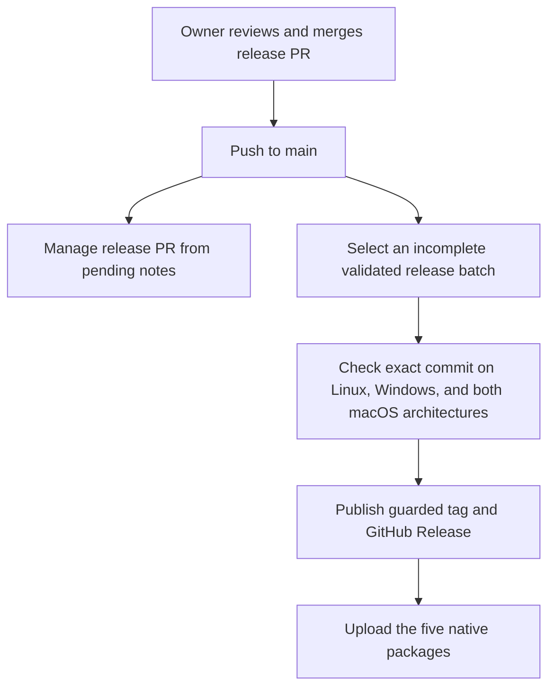

# Native packages

These scripts use the root Cargo application. They do not use Node.js, Tauri, or a webview.
The Rust toolchain is pinned in `rust-toolchain.toml`.

## Windows

Required tools: Rust MSVC, Microsoft C++ Build Tools with the Windows SDK, and NSIS 3.
The Windows SDK must include `fxc.exe` for GPUI's release shaders.

```powershell
choco install nsis --yes --no-progress
pwsh -NoProfile -NonInteractive -File packaging/windows/build.ps1
```

The script builds `target/release/mangameeya-rust.exe` and creates
`target/release/bundle/nsis/MangaMeeya-Rust_<version>_windows-setup.exe`.
`build.rs` embeds the original application icon. GPUI supplies the application
manifest with `asInvoker` and PerMonitorV2 DPI support.

The installer:

- Runs without elevation and installs to `%LOCALAPPDATA%\Programs\MangaMeeya Rust` by default.
- Creates a current-user Start menu shortcut and uninstall registration.
- Registers JPG, JPEG, JPE, PNG, GIF, BMP, WebP, ZIP, CBZ, RAR, and CBR under HKCU.
  - Uses `OpenWithProgids`, application capabilities, and a quoted file-open command.
  - Does not change extension defaults or `UserChoice`.
- Removes only its own files, shortcut, and registry entries on uninstall.
  - Keeps the user's preferences and reading history.

Close the reader before installation, upgrade, or uninstall. Both setup and uninstall
support `/S`. To test the installer on a clean Windows CI user profile:

```powershell
pwsh -NoProfile -NonInteractive -File packaging/windows/test-installer.ps1 -InstallerPath <setup.exe>
```

The test checks silent install, shortcuts, all 11 associations, unchanged extension
defaults, and uninstall. It does not start the GPUI window.

## macOS

Required tools: the pinned Rust toolchain and full Xcode with its Metal compiler.
Command Line Tools alone are not sufficient. Packages require macOS 12 or later.

```sh
export DEVELOPER_DIR=/Applications/Xcode.app/Contents/Developer
bash packaging/macos/build.sh
```

The script builds for the host architecture. For another architecture, install its
Rust target and pass `aarch64-apple-darwin` or `x86_64-apple-darwin` as the first argument.

Output is under `target/release/bundle/macos/<target>/`:

- `MangaMeeya Rust.app`
- `MangaMeeya-Rust_<version>_<target>.zip`
- `MangaMeeya-Rust_<version>_<target>.dmg`

The app includes native document associations for the same 11 extensions, with
`Viewer` role and `Alternate` rank. The script generates `icon.icns` from the original
`assets/icon-256.png`. The DMG includes an Applications shortcut.

Packages have only a local ad-hoc signature. They have no Developer ID signature or
notarization. Gatekeeper can block downloaded packages. The packaging script verifies
bundle metadata, architecture, signature integrity, and the DMG image. DMG verification
retries only `Resource temporarily unavailable`, with at most three attempts and two
seconds between attempts. Other errors fail immediately; verification is never skipped.
The script does not start the packaged application.

## Cross-check Windows code from macOS

This checks Rust code, including Windows-only paths. It does not link or run the
Windows application. Native Windows CI is still required for executable resources,
release shaders, and installer tests. GPUI's manifest must remain enabled.

```sh
brew install llvm
rustup target add x86_64-pc-windows-msvc
PATH="$(brew --prefix llvm)/bin:$PATH" \
CC_x86_64_pc_windows_msvc=clang \
RC_x86_64_pc_windows_msvc="$(brew --prefix llvm)/bin/llvm-rc" \
cargo check --locked --all-targets --target x86_64-pc-windows-msvc
```

## Launch IPC

`src/instance.rs` holds a per-user `fs2` lock and listens only on an ephemeral IPv4
loopback port. A 256-bit OS-generated token authenticates launch requests. The endpoint
file is private on Unix; Windows inherits the user's profile ACL. Tokens are not logged.
Before forwarding on Windows, the second process requests foreground activation
permission for the recorded primary PID. Windows can deny that permission; the
launch paths are still forwarded.

- The UI retains `PrimaryInstance` and polls `try_recv()`.
  - The first message contains the primary launch paths.
  - Every message activates the window; an empty list only activates it.
- Launch paths are made absolute in the sending process. Native path bytes are preserved.
- Messages contain only paths, not executable commands.
- Each launch permits at most 128 paths and 256 KiB of JSON.
- The receive queue permits at most 32 launch messages. Overflow is rejected.
- Each inbound connection has a total 500 ms read deadline. Startup retries for five seconds.
- Drop closes the listener and removes its endpoint before releasing the lock.
  - The empty lock file remains to prevent a race between different lock-file inodes.
  - A new primary replaces stale endpoint data after an unclean exit.

macOS LaunchServices can deliver documents and reopen events to an existing process
without starting another process. The UI handles these native events separately.

## CI

`.github/workflows/ci.yml` checks Rust formatting, tests, and Clippy on Linux x64,
Windows x64, macOS ARM64, and macOS x86_64. Linux installs Fontconfig, FreeType, XCB,
XKB, and Latin/CJK fonts for headless interaction and layout tests with the native
text system. These tests need no display server or GPU. Linux does not produce a
package or verify desktop launch or GPU rendering.

Windows and macOS build native packages and upload a separate artifact for each
target. Windows also runs the silent installer test. macOS jobs set `DEVELOPER_DIR`
to full Xcode and check the Metal compiler before Cargo builds.
All platforms run `cargo test --locked --test rendering` against the production UI.
Linux uses native text shaping. The Windows headless backend uses a no-op text system.
macOS uses its native text system and Metal renderer, and uploads
`target/ui-smoke/*.png` as separate artifacts, including screenshots available after
a failed test.

The workflow also accepts `workflow_call` with an exact `revision`. Both the release
checks and native matrix check out that commit. The Ubuntu release checks validate
workflow syntax, pending notes, version/lockfile changes, and asset-upload recovery.
They do not publish tags or Releases.

## Release workflow

`.github/workflows/release.yml` uses changenote v0.10.0, pinned to
`f4423760122463bf03a8d161c6f0bc4173afb6e0`. Its package configuration reads the root
`Cargo.toml`; normal changes do not edit the application version directly. Add a
pending note as described in [the note guide](../.changenote/README.md).



On an ordinary push to `main`, PR management and read-only selection run independently.
PR management updates `Cargo.toml`, `Cargo.lock`, `CHANGELOG.md`, the saved release
batch, and consumed notes on a managed branch. It never merges its PR. No saved batch,
or a fully published batch, selects no work. Pending notes alone do not publish a
release. Review and merge the generated PR to make its batch available for selection.

Publication waits for all checks and native packages for the selected commit.
Changenote verifies the generated release tree and receives that exact commit through
`expected-release-commit`. If a newer batch replaces it before publication, the run
fails rather than publishing another commit. Release text comes from the validated
changelog. Tags and existing release text are not replaced. All required publication
steps stay in this workflow because tags created with `GITHUB_TOKEN` do not trigger
other workflows.

The asset job downloads only the three native-package artifacts from the same run,
not the UI captures. It verifies the tag's commit and all five nonempty files before
uploading:

- One Windows x64 NSIS installer.
- A ZIP and DMG for macOS arm64.
- A ZIP and DMG for macOS x86_64.

Existing uploaded, nonempty assets are retained by name, not overwritten or compared
byte-for-byte. An empty or unfinished existing upload stops the job before any more
uploads; inspect and remove that failed asset manually before retrying. Only missing
files are uploaded. Inspect an incorrect existing asset manually;
automation does not replace it. API errors stop the job instead of being treated as
missing Releases. These assets remain unsigned on Windows and ad-hoc signed, without
notarization, on macOS. This workflow does not provide trusted signing credentials
or bypass platform download warnings.

### Required repository setting

A repository administrator must enable **Settings > Actions > General > Workflow
permissions > Allow GitHub Actions to create and approve pull requests**. The setting
was disabled when this integration was prepared. Branch rules must also allow the
managed release branch. The workflow gives only PR management `pull-requests: write`;
selection and native builds use read access, while publication and asset upload need
`contents: write`. Asset upload uses `PAT_TOKEN` when configured and otherwise uses
the job's `GITHUB_TOKEN`. No personal token is required by the configured flow.

PRs created with the default `GITHUB_TOKEN` do not start PR workflows automatically.
The release flow still runs exact-commit native checks before publication. If branch
rules require checks on the managed PR before merge, run **Native checks and packages**
manually on that PR branch, or have the repository owner configure an appropriate
GitHub App token. This integration does not change branch rules or create secrets.

### Manual operation and recovery

Run **Release** from the Actions tab on `main`:

1. `manage-pr` creates or updates the release PR. It cannot publish.
2. `retry-publication` selects the latest saved batch, including a completed GitHub
   Release, reruns its exact-commit checks, and retries publication and missing assets.
   - Use it after a partial upload, failed build, cancellation, or network error.
   - It does not require another version bump and does not run PR management.
   - It cannot recover an older batch after a newer batch replaces it. Finish the
     current release before merging the next release PR.

Disabling the Release workflow stops automation; unmerged release PRs do not change
`main`. Do not move tags or edit committed batch data for recovery. Inspect conflicts
and repository state before another attempt.

Local fixture tests use mocked GitHub commands and isolated Cargo files:

```sh
CHANGENOTE_BIN=changenote uv run --no-project python -m unittest discover -s tests/release -v
```

Install the pinned CLI and run `cargo fetch --locked` first to populate the offline
Cargo cache. These checks do not create remote tags, Releases, or PRs. Hosted publication,
Actions permissions, and download behavior are verified only by an authorized real
release; enabling this integration does not itself prove them.
