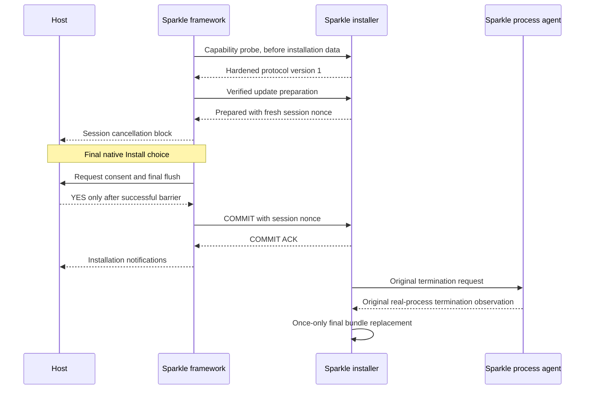

# Sparkle SDK hardening

This patch changes Sparkle 2.10.1, commit
`ab7d71291238df6e0492143b120c9b696a35f603`. It does not add an application updater.
The native GPUI gate remains blocked until its runtime tests pass on both targets.

## Source and scope

- `hardening.patch` is a Git-style patch against the exact upstream source.
- `patch-inputs.json` records the patch hash and exact input/output file hashes.
- The shared `../prepare_sdk.py` owns archive acquisition and SHA-256 verification.
  Its pinned source archive is the commit tarball, not the binary release archive.
- All policy changes are unconditional in this project fork. There is no setting,
  user default, command-line flag, or stock-SDK fallback that can authorize install.
- Sparkle still verifies, extracts, waits for the real process, replaces the bundle,
  and relaunches it. This patch does not add another replacement engine.

## Host bridge

Before SDK initialization, runtime-loaded hosts must check both conditions:

1. `SPUUpdater` responds to `+explicitInstallationCommitVersion`.
2. The method returns `1`.

Stock Sparkle does not have this selector. The framework also requires a version-1
helper handshake **before it sends installation data**. A stock helper cannot
prepare an install while the framework is detecting a mixed build.

The patched public `SPUUpdaterDelegate` adds these methods:

1. `updater:didPrepareInstallationWithCancellation:`
   - Retain this session's cancellation block while the update is prepared.
   - Call it before an ordinary quit. Wait asynchronously for its completion.
   - A nil error means the installer acknowledged disarm and staging removal.
   - An error, timeout, or lost connection is not an acknowledgement.
2. `updater:requestInstallationCommitForUpdate:completion:`
   - Sparkle calls this method after the final native Install choice.
   - Reply `YES` once, only after explicit user consent and a successful final
     host save/export/GPUI flush barrier. Keep that barrier closed afterward.
   - Reply `NO` on failure or cancellation. A missing method cannot authorize
     installation. A late or duplicate reply cannot send another COMMIT.
   - A sent COMMIT cannot be canceled. A COMMIT acknowledgement timeout has an
     uncertain result; it must not be treated as a successful cancellation.

All bridge calls and completions use the main thread. The host must not block that
thread while it waits. It must retain its delegate and session state. A destroyed
view, failed save, or missing reply must not produce a positive consent response.
The bridge does not implement or prove the application's flush barrier.



## Installer policy

1. Accept one original XPC connection. Require Sparkle's successful code-signing
   requirement validation; reject the no-Team-ID/no-requirement result.
   - Do not accept a replacement connection after preparation.
   - General external updaters and ad-hoc/unsigned XPC fixtures are not supported.
2. Generate a fresh 128-bit nonce with `SecRandomCopyBytes` after stage 1.
   - Keep authorization only in installer process memory.
   - Do not write the nonce or authorization to defaults, status records, or argv.
   - Reject a missing, wrong, expired, duplicate, or cross-session COMMIT.
   - Expire an uncommitted prepared session after 300 seconds of monotonic time.
3. Treat host termination, lost XPC, cancellation, and expiration before COMMIT
   as disarm, not authorization. Drain staging work and remove only this session's
   staging directory. The project network path accepts full ZIP archives only.
   - Retain the piped unarchiver, stop its owned task, and join its serial worker
     before removing staging. Ignore detached late completion/progress callbacks.
     The SDK helper drain does not wait on main-thread notification execution.
   - Do not call final bundle replacement.
   - Send CANCEL ACK only after disarm and successful staging removal.
   - Keep the original connection alive until ACK consumption or a short cleanup
     deadline. A delivery failure is not reported as a successful ACK.
4. Allow final replacement once, only after COMMIT **and** the existing Sparkle
   process agent reports real host termination.
   - Legacy RESUME cannot authorize installation. After COMMIT it can only retry
     the existing termination request. The real process wait remains in place.
5. Restrict this fork to its running application as both update and relaunch target.
   Require an exact incoming bundle identifier match and exactly the running host
   executable slice (`__x86_64__` or `__arm64__`), not the hardware architecture.
   - Reject universal payloads. Otherwise a Rosetta x86_64 session could relaunch
     the new universal bundle as arm64. Project packages are single-architecture.
   - Require a nonempty expected version and an exact match with the incoming
     CFBundleVersion. Require the actual incoming version to be strictly newer
     than the installed version; reject signed equal-version replay.
   - Retain Sparkle's existing signature checks.
6. If replacement and restoration both fail, retain the old app backup during
   cleanup. Include its path in `NSFilePathErrorKey` and the installation error.

The SDK cannot distinguish a consented quit from a crash **after** COMMIT. Both
complete the committed installation after the real process wait. Before COMMIT,
neither event permits installation.

## Reproduction

The shared preparation tool verifies the pinned archive and applies the patch:

```sh
uv run --no-project python packaging/updates/prepare_sdk.py sparkle \
  --archive target/update-planning/source/sparkle-ab7d712.tar.gz \
  --output target/sparkle-hardening/prepared
```

The archive argument is optional when the shared tool is allowed to fetch it.
No SDK binary is included in this change.

Check the patch against a separate, untouched pinned source tree:

```sh
uv run --no-project python tests/updates/sparkle/check_patch.py \
  --source target/update-planning/source/Sparkle-ab7d71291238df6e0492143b120c9b696a35f603
```

On each native macOS runner with full Xcode, use a new output directory:

```sh
uv run --no-project python packaging/updates/sparkle/build_sdk.py \
  --source target/sparkle-hardening/prepared/source \
  --output target/sparkle-hardening/native-arm64 --arch arm64
```

Use `--arch x86_64` and a separate output directory on the Intel runner. The helper
uses `xcodebuild build` and `xcodebuild test`, not release scripts or `make release`.
It checks xcresult counters and every expected test method before reporting success;
an empty selection, skipped test or incomplete result cannot pass.
It sets `MACOSX_DEPLOYMENT_TARGET=12.0`, one exact architecture, and Xcode ad-hoc
fixture signing (`CODE_SIGN_IDENTITY=-`). It does not use a production identity,
keychain provisioning, or an XPC authentication bypass. See
`tests/updates/sparkle/README.md` for test coverage and limits.

For later maintenance, edit a new ignored private source copy, export a Git-style
diff against the untouched pin, and update the input/output hash manifest. Review
every changed path and hunk. Do not change SDK pins to make a patch apply to a
different source tree.

## Current evidence

Host: Windows Python 3.13.9 with uv 0.9.5; WSL2 x86_64 with GCC 15.2.0 and Git
2.53.0. The patch SHA-256 is recorded in `patch-inputs.json`.

| Check | Result |
| --- | --- |
| Actual patch apply, 16 exact output hashes, double-apply rejection | Passed |
| Production C policy and four POSIX process sessions, `-O2 -Wall -Wextra -Werror` | Passed |
| Same executable tests, AddressSanitizer + UndefinedBehaviorSanitizer | Passed |
| Twelve portable build-helper and XCTest evidence guard tests | Passed |
| Python bytecode compilation | Passed |
| `git diff --check` | No whitespace diagnostics |
| Native helper on this host | Unsupported, exit 1; no native checks ran |

The first Windows patch-copy check found Git's CRLF conversion in the temporary
copy. The final check sets `core.autocrlf=false` for its own commands and passes;
it does not change global Git settings. `.gitattributes` preserves upstream
whitespace in patch context/removal lines. Applying the patch still uses
`--whitespace=error` for added SDK source lines.

No Xcode build, native XCTest, authenticated XPC session, Sparkle A/B runtime
update, or GPUI test ran here. No signing command, production-key access, or
publication ran here.
