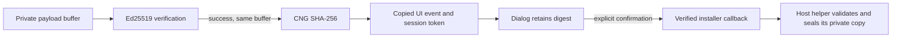

# WinSparkle source hardening

This directory contains an altered WinSparkle SDK, not an application updater.
The full native update gate remains open. No production installer, key or SDK
binary is included.

## Source and patch identity

- WinSparkle: `0.9.4`, commit
  `a8986caf620262f7d4581b241436ceaa0cc9370f`.
- Complete release source: `WinSparkle-0.9.4-src.zip`, 64,991,527 bytes.
- Source archive SHA-256:
  `cd77040f828dce0adcf8f0205f776238197deb24f5108bf01a3e5623b703a3b9`.
- Patch: [`hardening.patch`](hardening.patch).
- [`preimages.json`](preimages.json) records the exact before/after SHA-256 of
  each changed file. Original BOMs, CRLF/LF and missing final newlines are handled
  by the patch. Do not normalize files before applying it.

The complete release archive pins the released wxWidgets, Expat and Ed25519
sources. The changed source preimages also match the pinned Git archive after
EOL comparison. Do not replace these dependencies with current branch heads.
The stock binary ZIP is not the input and does not have the new capability.

## C ABI contract

```c
unsigned int __cdecl win_sparkle_get_hardening_version(void); /* returns 1 */
typedef int (__cdecl *win_sparkle_verified_installer_callback_t)(
    const wchar_t *path, const unsigned char sha256[32]);
void __cdecl win_sparkle_set_verified_installer_callback(
    win_sparkle_verified_installer_callback_t callback);
```

1. Load the DLL by a trusted absolute installed path. Require both new exports
   and hardening version `1`. Do not accept a stock DLL by version string alone.
2. Before initialization or checks, set a reviewed Ed25519 public key and the
   verified-installer callback. Check that the public-key setter returns `1`.
   - The setter requires canonical base64 that decodes to exactly 32 bytes.
   - The app must supply a genuine, reviewed Ed25519 public key. A downloaded
     key is not a trust anchor. This patch adds no new curve implementation.
   - Resource keys are checked by the same validation before checks/downloads.
3. The verifier reads one private buffer and keeps it `const`. The existing
   Ed25519 implementation verifies that buffer. Only after verification succeeds,
   Windows CNG computes SHA-256 over the **same buffer**.
   - No file mapping, second pathname read or callback-time hash creates the
     trusted digest.
   - Signature, file-read, allocation or CNG errors stop the download path.
   - Nonempty NSIS payloads up to 512 MiB are supported. The download sink
     checks actual bytes before writing; the verifier checks size before allocation.
4. The SDK copies the path, digest and download-session token into the UI event.
   The dialog retains the digest until explicit installation confirmation.
   A cancelled session's completion cannot populate a different download.
5. After confirmation and shutdown consent, the callback receives borrowed
   UTF-16 path and 32 digest bytes. Copy them before returning.
   - The path can have changed since verification. It is not an immutable
     handle and is not a trust root.
   - The host's future helper must compare its private copy with this trusted
     digest and prevent changes to that copy through execution. It must reject
     replacement, truncation and reparse races. This patch does not implement
     that helper, save barrier, READY/COMMIT/CANCEL channel or NSIS rollback.
   - Return `1` only after the host accepts responsibility for safe handoff.
     Every other result, a missing callback or an exception fails closed.
     The SDK requests host shutdown only after success.
   - The SDK never calls the path-only installer callback or executes a default
     installer. There is no unsigned, DSA, browser-page or ShellExecute fallback.
     Feed installer arguments are not used.
6. Both download and installation require confirmation. The old
   `check_update_with_ui_and_install` export is a compatibility alias for the
   normal confirmed check. Closing the window does not authorize installation.
7. All notification callbacks are copied under the configuration lock and
   invoked after unlocking. They must not wait without a deadline for host work.
8. The DLL and callback storage have **process lifetime**.
   - `cleanup()` only stops the SDK UI thread. Upstream worker shutdown is still
     incomplete; it is not an unload barrier.
   - Do not unload the library or destroy callbacks with a view. Do not call
     cleanup from a callback or while a callback waits for the calling thread.
   - The new handoff and shutdown callbacks run without the SDK configuration
     lock held. The host must use bounded, thread-safe UI coordination and must
     not let exceptions or Rust panics cross the ABI.



## Other source changes

1. Download responses cannot select a local filename. The SDK always writes
   `payload.exe` in its newly created temporary directory, independent of URL
   basename or Content-Disposition. It never parses response filenames.
2. Notes use a bounded read-only `wxTextCtrl`. HTML and script syntax are literal
   text. `releaseNotesLink` is not fetched. WebView2 and IE webview compilation
   and package imports are removed; the browser backend configuration is off.
3. Feed and payload requests require HTTPS. WinINet automatic redirects are off.
   Each redirect is checked before the next request; at most five are allowed.
   HTTP, local-file schemes, URL credentials and non-200 final responses fail.
   WinINet certificate errors are not ignored. Custom headers are not forwarded
   to redirected URLs. This is transport policy, not a signed-feed claim.
   - Requests are synchronous on the existing SDK worker. There are no WinINet
     callbacks or borrowed asynchronous read buffers. The worker checks cancellation
     before and after each open/read and redirect.
   - Connect, send and receive phase timeouts are 10,000 ms, with one connection
     attempt. They are not a whole-operation deadline. Cancellation waits for the
     current WinINet call; its real UI latency must pass the integration gate.
4. Appcasts are limited to 1 MiB of actual bytes before append and XML parsing.
   Payloads are limited to 512 MiB before writing and verifier allocation. A false
   Content-Length cannot remove either limit. XML size is checked before int conversion.
5. One failed periodic check no longer ends the existing scheduler. It waits for
   its normal interval; it does not start a second timer or busy retry.
6. An active or ready download retains its selected offer through confirmation.
   Other checker results cannot replace it. Progress, errors and completion carry
   the download token, so stale events cannot alter another active download.
7. The DSA verifier and OpenSSL includes are removed from SDK source. MSBuild,
   solution, Bakefile and CMake entry points exclude libcrypto/DSA. CNG supplies
   SHA-256; Windows CryptoAPI supplies base64. Existing Ed25519 is unchanged.
   - The release source archive still contains unused upstream legacy source
     directories/project files. They are not built or shipped by this recipe.
   - The old DSA setter returns `0`; the old path-only callback setter is inert.

## Build and focused native checks

Run from the repository root with native Windows Python and Visual Studio C++
tools. Use Visual Studio 2022/MSVC v143 on `windows-2022` for the planned CI build.
The upstream toolset property also supports local Visual Studio 18/MSVC v145.
Windows SDK CNG headers/libraries and MSBuild are required. No Cargo build,
product UI or production signing material is used.

```powershell
uv run --no-project python packaging/updates/prepare_sdk.py winsparkle `
  --archive target/update-planning/winsparkle-gate/WinSparkle-0.9.4-src.zip `
  --output target/updater-sdk/winsparkle

uv run --no-project python packaging/updates/winsparkle/build_sdk.py `
  --source target/updater-sdk/winsparkle/source `
  --output target/updater-sdk/winsparkle/native
```

Both prepare and build outputs must be new directories under the repository's
`target/`. The runner checks source provenance before creating build output.
Omit `--archive` to use the pinned public source URL. The shared prepare tool verifies the archive, applies the patch in an
isolated private Git repository with `--whitespace=error`, and records provenance.
The build runner checks all patched-file hashes before building.

The runner locates Visual Studio with `vswhere`, captures only compiler-related
VsDevCmd variables, and uses these MSBuild operations:

```text
MSBuild.exe <source>/WinSparkle.sln /t:Restore /p:RestorePackagesConfig=true
  /p:NuGetInteractive=false /p:RestoreSources=https://api.nuget.org/v3/index.json
  /p:Configuration=Release /p:Platform=x64
MSBuild.exe <source>/WinSparkle.sln /t:WinSparkle /m:2
  /p:Configuration=Release /p:Platform=x64 /p:OutDir=<output>/dll/
```

`CL=/utf-8` is set for UTF-8 upstream sources. The only restored NuGet package is
`Gettext.Tools 0.26.0`; its NUPKG SHA-256 is checked before the build:
`8e2ff0a055778ad72c0077e09a30028011816c9eac5168aa2c88101a4ddde1a0`.
It supplies translation build tools and is not a DLL runtime dependency.
No global tools are installed. CMake entry points are patched but not validated
as a supported build recipe; use MSBuild.

The runner then compiles [`native.cpp`](../../../tests/updates/winsparkle/native.cpp)
against the actual altered SDK source and released static dependencies. It tests:

1. Mandatory key/callback configuration and disabled DSA.
2. Valid Ed25519 plus the SHA-256 `abc` known answer; missing, malformed, wrong-key,
   empty, changed and truncated payload/signature rejection.
3. Digest and token copies in the actual wx event payload; retained trusted
   digest after pathname bytes change.
4. Callback success, invalid return values, absence, exception and cross-thread
   configuration access without a callback-lock deadlock.
5. Rejection of insecure/local URLs and URL credentials before a request.
6. The actual fixed-name download sink with a traversal/ADS/MSI-style name.
7. A hidden native read-only notes control with literal script/link text and a
   remote notes URL that is not fetched.
8. New exports in the built DLL, loaded in a separate restricted-search child
   process without initializing its workers. Only the DLL directory and System32
   are used for dependent-library search.
9. Synchronous open/read/EOF and failure paths through a deterministic WinINet
   seam over the real download source, including checked options and handle closure.
10. Real loopback TLS error, receive stall and three in-flight cancellation cases.
    No certificate store or TLS trust setting is changed. These are negative
    transport tests, not a successful authenticated HTTPS payload download.
11. Actual-byte feed/payload bounds, XML bounds and sparse oversize verifier input.
12. The periodic worker survives a failed iteration, avoids a busy retry and exits
    on cancellation. This is not an hour-long schedule or clock-change test.
13. Every notification callback can call a cross-thread configuration setter.
14. Hidden real controls retain the active/ready offer and reject stale token events.
    Ready data is injected from an inert verified digest, not a live HTTPS success.

For source checks only, on either Windows or Linux:

```text
uv run --no-project python tests/updates/winsparkle/check_patch.py --source <prepared>/source
```

Output includes `dll/WinSparkle.dll`, the native test executable,
`dll-imports.txt`, `dll-exports.txt`, build/test logs and `evidence.json`. Keep these files under
ignored `target/`; do not commit or redistribute test binaries.

## Recorded evidence and remaining limits

The exact ZIP patch, all 26 after-image hashes, 14 source checks, x64 DLL
compilation, focused native executable and built-DLL ABI probe passed on this
Windows host with Visual Studio 18/MSVC 14.51. Native source builds used the
pinned released dependencies. Current native logs are under
`target/update-planning/winsparkle-lifecycle-native/`. The real local TLS stall
completed in 12,053 ms with a configured 10,000 ms phase timeout; do not infer a
hard total deadline from the setting. Seven portable build-helper guard tests
also passed; their mocked platform checks are not native runtime proof.

Initial checks exposed and fixed test/build tooling errors: UTF-8 source decoding
on a CP950 host, native-test system libraries, missing wx application initialization,
Windows executable lookup, and missing final-newline markers in patch generation.
A nested-worktree `git apply` invocation initially skipped paths; the final proof
uses an isolated prepared source plus exact after-image hashes. No acceptance
condition was removed to get a pass.

These results are **not** a full updater, native SDK integration gate or
production acceptance pass. In particular, these remain unverified:

1. Positive authenticated HTTPS payload downloads, live redirect/TLS policy
   failures, full download interruption and visible UI cancellation stress.
   The negative loopback tests and deterministic seam do not prove these.
2. Visible UI confirmation/cancel/reopen concurrency and full host event-loop
   coexistence. The event test checks a real wx payload copy, not a complete
   worker-to-user-confirmation run.
3. Host save/flush veto, export barrier, helper READY/COMMIT/CANCEL, process wait,
   sealed-copy execution, concurrent startup/update gate, downgrade checks,
   NSIS upgrade/rollback/relaunch and production package layout.
4. Shutdown/deadlock stress, remaining upstream worker cleanup, and full callback
   lifetime tests. This patch does not claim worker termination or safe unload.
5. Windows-2022/v143, Win32, ARM64 and MinGW/CMake execution. The local proof is
   x64/v145 only; CI evidence must be obtained separately.
6. Production public-key review, signing, complete dependency-notice packaging
   and final redistribution review. Removing legacy OpenSSL from the build
   resolves that selected dependency path; it is not a blanket license clearance.

Retain WinSparkle `COPYING`, Expat `3rdparty/expat/expat/COPYING`, Ed25519
`3rdparty/ed25519/license.txt`, and the applicable wxWidgets license/third-party
notices when later packaging the DLL. These patches are clearly altered source;
do not represent their output as the stock official WinSparkle binary.
